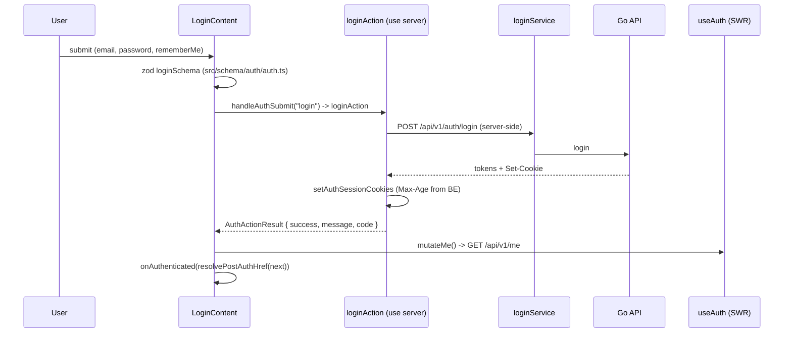
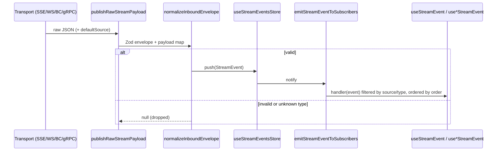

# Features

Feature-area reference for `fe-mycourse`. One entry per feature area, not per file: rules and flows are written once, here. Route tables live only in [`PAGES.md`](PAGES.md); reusable assets only in [`SHARED.md`](SHARED.md); stack, directory map, conventions and the API layer in [`ARCHITECTURE.md`](ARCHITECTURE.md).

Grep hint: `grep -n "^## " docs/FEATURES.md` lists the entries; read the matching entry plus the slugs in its `Related:` line, not the whole file.

Entry template: `Summary`, `Rules`, `Flow`, `API`, `Screens/Routes` (slugs into `PAGES.md`), `Code`, `Permissions`, `Related`, `Gotchas`. Mermaid is kept only where error-code or conflict branching is the hard part.

Entries: `auth`, `home-and-catalog`, `seo-web`, `instructor-application`, `instructor-admin`, `taxonomy-admin`, `course-editor`, `course-review-admin`, `media`, `dashboards-and-access`, `realtime-streams`.

---

## auth

**Summary:** Email/password login, register + email confirm, logout, Discord/Google social login, silent token refresh, and the current-user (`/me`) mirror that drives the header and every permission gate. Login and refresh run on the Next.js server (Server Actions / BFF) so tokens never appear in the browser network panel.

**Rules:**
- Session = three HttpOnly cookies set by Server Actions: `access_token`, `refresh_token`, `session_id`, plus FE-only `auth_session_expires_at` (absolute Unix-seconds expiry, fallback when BE `Set-Cookie` Max-Age is unavailable). Names are constants in `src/constants/auth-cookie.ts` (`ACCESS_TOKEN_COOKIE`, `REFRESH_TOKEN_COOKIE`, `SESSION_ID_COOKIE`, `AUTH_SESSION_EXPIRES_AT_COOKIE`, `LEGACY_AUTH_SESSION_MAX_AGE_COOKIE`, `AUTH_COOKIE_NAMES`); never repeat the literals.
- Cookie options (`buildAuthCookieOptions`, `src/lib/utils/cookie.ts`): `httpOnly`, `sameSite=lax`, `secure` in production, `domain` = `AUTH_COOKIE_DOMAIN` (must equal the BE value on multi-subdomain hosting). TTL is **not hardcoded on FE**: refresh/session Max-Age is parsed from BE `Set-Cookie` (`refreshMaxAgeFromBeSetCookie`); `access_token` has no `maxAge`.
- Browser requests use `credentials: "include"` and never set `Authorization`; BE reads the `access_token` cookie. Server-side requests read the cookie through `next/headers` and attach `Authorization: Bearer`. Missing cookie => BE `401 "missing bearer token"`.
- Refresh is eligible only on `401`/`403`, not already retried, and either `X-Token-Expired: true` or a `401` with no outgoing Bearer. One retry only. Browser: single-flight `POST ${origin}/api/auth/refresh` (absolute same-origin URL; a relative one fails URL parsing in `fetch-core`), FE proxy forwards `X-Refresh-Token` + `X-Session-Id` and rewrites cookies; Server writable: `rawPostRefreshUpstream` (`src/api/auth/refresh-upstream-raw.ts`, `redirect: "error"`, trusted origin) then `setAuthSessionCookies`; Server read-only: throw `ApiRefreshRequiredError` (expected, not reported). `session_id` does not change on rotation; `access_token` and `refresh_token` do. The browser-facing refresh DTO is access_token-only (`data.access_token`; the browser adapter exact-validates top-level keys `{code,message,data}`). The refresh Route Handler exact-validates the upstream `{code,message,data}` envelope (finite integer code, non-empty string message) and answers a safe `502` on malformed upstream; error responses use fixed messages and allowlisted codes only.
- Server redirect following (`followServerRedirects`, `src/api/core/fetch-core.ts`) follows only 301/302/303/307/308; `304` and other 3xx are returned as the final response.
- Errors in UI always go through `translateApiErrorCode(useTranslations("errors.codes"), result.code)`; never show `result.message`. Register rate-limit `4010` keeps a `Retry-After` countdown (`mapAuthApiError(error, { includeRetryAfter: true })`).
- `/me`: `getMeService` returns `null` on `401` (guest, not an error) and throws otherwise. `useAuth` (`src/api/hooks/auth/useAuth.ts`) uses `shouldRetryOnError: false`, `revalidateOnFocus: true` (the only hook that revalidates on focus; global `SWRConfig` sets it `false`, `dedupingInterval: 30_000`, `errorRetryInterval: 180_000`, see `src/constants/swr.ts`). `MeSwrSync` runs `useSyncMeFromAuth` inside the provider so the Zustand mirror (`useGetMe()` -> `me`, `isLoading`, `isError`, `mePermissions`, `mutateMe`) shares its SWR context.
- `meCacheProvider` (`src/lib/swr/me-cache-provider.ts`) persists only the `/me` entry to `sessionStorage` (`beforeunload`) and restores it on init, so full-page `/login`<->`/signup` hard navigations do not flash "logged out". It is a client-only singleton; the server branch returns a fresh `Map` per request (a server singleton would leak one user's `/me` into another's SSR). `useAuth` skips the on-mount fetch only on `/login`/`/signup` and only when the persisted entry is younger than `SWR_DEDUPING_INTERVAL_MS`; an unscoped skip once let a revoked session survive a reload of a protected page (`e2e/tests/auth.spec.ts` "an expired/revoked session logs the user out on the next check").
- `MeResponse.permissions` is the only authorization source; `MeResponse.roles` is display-only (BE order, unknown names allowed). `MeResponse.slug` is display data (`""` until assigned), never an identity key; `avatar_url`/`avatar_object_key` are optional. Re-login is required after a BE permission-matrix change (JWT cache).
- Post-auth destination: `next` query param, read only through `useAuthNextParam()` and accepted only when it passes both `isSafeInternalPath` and not `isAuthRoutePath` (`src/lib/security/web/safe-redirect.ts`); default `resolvePostAuthHref` => `/home`. An invalid `next` is stripped with raw `window.history.replaceState` (a router call would trigger modal interception).
- Social login: popup shows Discord + Google only. Discord: `startDiscordLoginAction` stores random `state` + `entrypoint` + `remember_me` in 600 s HttpOnly cookies and returns the authorize URL (`redirect_uri` = `NEXT_PUBLIC_DISCORD_CALLBACK_URL`, must equal BE `DISCORD_CALLBACK_URL`; never derived from request headers; no PKCE). Google: GSI code client popup or One Tap (`GoogleOneTapHost` for guests; GSI script loaded only in `(web)/layout.tsx`). X (PKCE + state, `NEXT_PUBLIC_X_CALLBACK_URL`) is retained but not wired to the popup. Callback pages `src/app/auth/{discord,x}/callback/page.tsx` are locale-less with English-only relay copy; `src/proxy.ts` matcher must exclude them or next-intl redirects to `/{locale}/auth/...` (404, popup never completes). The BE `/auth/google/mobile` endpoint is not in the web route map.
- All login-like actions (`loginAction`, `confirmAction`, every OAuth action) use `finalizeAuthLoginAction` + `mapAuthApiError` (`src/lib/utils/auth-action.ts`); reuse it for any new login-like action.
- Error codes: BE `4013`-`4017`, `4019`, `4023`-`4025` (`InvalidGoogleCode`, `GoogleEmailNotVerified`, `OAuthIdentityConflict`, `InvalidXCode`, `XEmailUnavailable`, `XAccountLinkRequired`, `InvalidDiscordCode`, `DiscordEmailNotVerified`, `DiscordEmailUnavailable`); FE-local (not in BE/Swagger) `4018` invalid OAuth state (`ApiErrorCode.InvalidOAuthState`), `4020` Google not configured, `4021` popup blocked, `4022` X start failed, `4026` Discord start failed (`ApiErrorCode.DiscordOAuthStartFailed`: missing client id or callback URL). Toasts use `auth.socialLogin.*`.
- Permission checks: `PERMISSIONS`/`PERMISSION_IDS`/`ROLES` in `src/constants/`, `hasPermission`/`hasAllPermissions` (AND, mirrors BE `RequirePermission`)/`hasAnyPermission`/`satisfiesPermissions`/`filterPermissionNavTree` in `src/lib/utils/permission.ts`, hooks in `src/hooks/auth/use-permissions.ts`, `PermissionGate`. Config rule: `permissions` undefined or `[]` => visible when authenticated; `permissionMode` default `"all"`; `"any"` => OR. Not logged in => `mePermissions = []` => every check false. Nav filtering is bottom-up: a leaf with `href` needs its own permission, a branch without `href` stays while any permitted descendant remains, empty groups are dropped.
- Cookie utilities (`getCookieValue`, `setCookieValue`, `src/lib/utils/cookie.ts`) are isomorphic: browser = `js-cookie`; Server Action/Route Handler = `next/headers`; pure RSC read-only = write is a silent no-op. Branch on `isServer()` (`src/lib/utils/runtime.ts`).

**Flow:**



- Register: `SignupContent` -> `registerAction({ ..., locale })` -> `POST /auth/register` (`email`, `password`, `display_name`, `locale`), `201`, no cookies; UI shows "check your email" and the modal stays open. BE email link: `{APP_CLIENT_BASE_URL}/{locale}/confirm-email?token=<uuid>`.
- Confirm: `ConfirmEmailContent` (once) -> `confirmAction({ token })` -> `POST /auth/confirm` -> `setAuthSessionCookies` -> `mutateMe()` + broadcast `confirm_success` + `router.replace("/home")`. Background tabs reload on focus via `useAuthConfirmTabSync` (`sessionStorage` key `mycourse:pending_auth_tab_reload`); the confirming tab does not reload.
- Logout: `/{locale}/logout` -> `LogoutContent` (once) -> `logoutAction()` -> `POST /auth/logout` -> `clearAuthSessionCookies` -> `mutateMe()` + broadcast `logout` + `router.replace("/")`. Other tabs: `useAuthLogoutTabSync` -> `mutateMe()` + `window.location.reload()`.
- Social (Discord): `useDiscordLogin` -> `startDiscordLoginAction` -> `window.open(authorizeUrl)` -> popup `/auth/discord/callback` `postMessage({code,state})` -> `discordLoginAction` (validates `state` cookie; mismatch => `4018`) -> `finalizeAuthLoginAction` -> `useOAuthPostAuth` (`mutateMe` + `onAuthenticated(resolvePostAuthHref(next))`). Google: `useGoogleLogin` -> GSI code client -> `googleLoginAction`; One Tap: `googleOneTapAction({ credential })`.
- Signed-in redirect: with `refresh_token` and `session_id` cookies present, `src/proxy.ts` answers `/vi`/`/en` with `307` to `/{locale}/home` (see [`PAGES.md`](PAGES.md)).
- Refresh decision:

```
401/403 eligible? -- no --> reportApiError -> throw ApiHttpError
  |yes
  already retried? -- yes --> report + throw
  server writable  -> rawPostRefreshUpstream -> setAuthSessionCookies -> retry once
  server read-only -> throw ApiRefreshRequiredError (no report)
  browser          -> single-flight POST /api/auth/refresh -> retry once with rotated token
  failure          -> throw original ApiHttpError with sanitized cause + report
```

- Global error reporting (`reportApiError`, `src/api/transport/api-transport.ts`): skips guest `GET /me` 401, `ERR_BLOCKED_BY_CLIENT`, `ApiRefreshRequiredError`; logs other 4xx/5xx, timeout, abort, network, parse, policy, replay once per incident; custom `[API]` console only when `isServer()` or `NODE_ENV === "development"`; browser Zustand `useApiError` (`src/store/api-error-store.ts`, last 20 entries of `ApiErrorEntry { id, statusCode, appCode, message, url, method, timestamp }`) is filled on the client path only. BFF refresh maps `ApiTimeoutError` to `504`.

**API:** `POST /api/v1/auth/{register,login,confirm,refresh,logout}`, `POST /api/v1/auth/{google,google/onetap,discord,x}` (constants `API_PUBLIC_ROUTES.auth.*`), FE proxy `POST /api/auth/refresh`; `GET/PATCH/DELETE /api/v1/me`, `DELETE /api/v1/me/hard`, `GET /api/v1/me/permissions` (`API_PRIVATE_ROUTES.user.{getMe,patchMe,deleteMe,hardDeleteMe,getMyPermissions}`). `PATCH /me` body `{ avatar_file_id?: uuid, slug?: string }` (`updateMeSchema`, `src/schema/me/me.ts`; omitted `slug` = unchanged, a taken slug is auto-suffixed by BE and returned, never `409`). Callers: `src/api/callers/auth/auth-factory.ts` (isomorphic `createAuthCallers`) + `auth-browser.ts` singletons; Server Actions import `auth-factory` only.

**Screens/Routes:** `login`, `signup`, `logout`, `confirm-email`, `@modal` login/signup interception, `auth/discord/callback`, `auth/x/callback` (see [`PAGES.md`](PAGES.md)).

**Code:** `src/actions/auth/{auth,auth-client,google-oauth,discord-oauth,x-oauth}.ts`, `src/lib/utils/{auth-action,auth-session,cookie,oauth-popup-cookies}.ts`, `src/api/{callers/auth,hooks/auth,auth,transport}`, `src/app/api/auth/refresh/route.ts`, `src/hooks/auth/*` (`use-auth-store`, `use-permissions`, `use-google-login`, `use-google-one-tap`, `use-discord-login`, `use-x-login`, `use-oauth-post-auth`, `use-oauth-popup-login`, `use-auth-next-param`, `use-redirect-if-authenticated`, `use-auth-modal-background-bridge`), `src/components/common/auth-menu/**`, `src/components/auth/oauth-popup-callback-relay.tsx`, `src/components/providers/google-one-tap-host.tsx`, `src/store/{auth,api-error-store}.ts`, `src/lib/swr/me-cache-provider.ts`.

**Permissions:** none required to log in; `MeResponse.permissions` gates the rest of the app.

**Related:** `dashboards-and-access`, `media` (avatar PATCH via `MediaCollectionDialog`), `realtime-streams` (cross-tab `confirm_success`/`logout`), `home-and-catalog`.

**Gotchas:** a soft navigation to `/login`/`/signup` is always intercepted as a modal, so any "no modal here" case must be a plain `<a href>` hard navigation (see the route-based modal rules in [`PAGES.md`](PAGES.md)); `useRedirectIfAuthenticated` snapshots `me` once on first resolved check and must not react to a later guest->authenticated change (it once raced `onAuthenticated` and hijacked the destination); `useGetMe` cache can keep a stale avatar after cookies clear (known, pre-existing).

## home-and-catalog

**Summary:** Guest marketing home at `/{locale}` (mock data, indexable), signed-in home at `/{locale}/home` (hero carousel + three catalog/learner sections fed by real APIs, noindex), the public course-detail placeholder `/{locale}/courses/{slug}`, and the search stub.

**Rules:**
- Guest `/{locale}` (`HomePage`, `src/screen/common/home/page.tsx`, async Server Component) is the **only** SEO-indexable public key: `generateMetadata` via `buildPageMetadata` (`homepage.seo.title` / `homepage.seo.description`, canonical `/{locale}`, hreflang `vi` + `en` + `x-default`, OG/Twitter without image because the repo has no real image asset) plus Organization JSON-LD (`JsonLd` + `buildOrganizationJsonLd({ name, url })`, no logo, no `sameAs`, never fed from mock course data). It is composed of `HeroSection`, `SearchSection`, `TopCoursesSection`, `AdvancedPromoSection`, `TrendingCoursesSection`, `UpcomingWebinarsSection`, `PromoSection` under `src/components/home/`; `CourseCard` renders `next/image` when `course.imageUrl` exists. Static images live in `public/assets/images/home/`.
- A signed-in browser never reaches `/{locale}`: `src/proxy.ts` answers `307` to `/{locale}/home` when both `refresh_token` and `session_id` cookies exist (presence check only, `Cache-Control: private, no-store`, `Vary: Cookie` on the redirect only). Googlebot sends no cookies, so it always receives the public home. A request to `/` takes two hops (next-intl to `/{locale}`, then the proxy).
- Signed-in `/home` (`PRIVATE_ROUTES.home`, `SignedInHomePage`, `src/screen/common/home/signed-in-home-page.tsx`, client component) is a client-side login gate: while `useGetMe` loads show a spinner; a guest without cookies never reaches it (the proxy redirects `/{locale}/home` to `/{locale}`); only a visitor with stale cookies sees the CTA `<Link href={loginHref(signedInHomeHref)}>` to `/login?next=/home`; no home request is made without a session; it never redirects back to `/` (prevents loops). Metadata: localized title `home.signedIn.pageTitle` + `noindex,nofollow` (`privateApp` robots preset); crawl disallow derives from `PRIVATE_ROUTES`; no canonical, OG or JSON-LD. Do not emit `Course`/`Offer`/`AggregateRating`/FAQ/video JSON-LD from this data, and never put personalized data in metadata or public cache.
- Order for signed-in users: `HeroCarousel` (3 Figma slides, no arrow buttons, drag/swipe + dots, 3 s autoplay via `useCarouselAutoplay` (interval `HOME_HERO_AUTOPLAY_INTERVAL_MS`) that restarts on manual change, one `h1`, static images under `public/assets/images/home/hero/`); **Complete your Course** (`useContinueLearning`, only when the user holds `course:read`; initial 3, Expand More -> 10; progress bar + "completed/total sub-lessons completed"); **Trending Course** (`useTrendingCourses`; initial 8, Expand More -> 24; no price, rating or badge); **Popular Instructor** (`usePopularInstructors`; 4 cards, not links). Limits live in `src/constants/home.ts`; `useExpandMore` extends the list in place and never navigates.
- Each data section handles loading (skeletons), empty and error (with retry) independently through `HomeSectionShell`. Below `sm` (640 px) the cards of the three sections form one horizontally swipeable scroll-snap row (each card 85% wide so the next peeks in; no scrollbar, no page overflow); from `sm` up they keep grids (2 columns, 4 from `lg`; 3 for Complete your Course). Course cards link to `/courses/{slug}` only when `slug` is non-empty; `slug`/`owner_slug` may be `""`/absent until the BE backfill and are never used as keys. Remote thumbnails and instructor pictures use `next/image` with `unoptimized`.
- Figma (file `Mh8LEZPNctm96sQhhTNRJD`, signed-in frame node `4990:51595`): not implemented by product decision are topic chips, "Based on your interest", "More from MyCourse Studio", "Popular Category", and badge/price/rating on cards (the BE does not return them). All Figma text, ratings, prices and courses are UI illustration only, never metadata or course data until a real public DTO exists. Layout constraints: one H1 in the hero, section H2s, real interactive semantics for chips, image alt + dimensions, `priority` only for measured LCP.
- `/courses/{slug}` renders `CourseDetailPlaceholderPage` (temporary "coming soon", noindex); `courseDetailHref(slug)` builds it from `PUBLIC_RESOURCE_ROUTES.course`. `defaultPostAuthHref` = `signedInHomeHref` (`/home`), used when no valid `next` exists; logout, brand logo, `navigateToHome`, not-found/status-error "back to home" and global-error keep `homeHref` (`/`).
- Search is a UI stub: `SearchBar` (`src/components/shared/search-bar.tsx`) receives focus/input in auth forms and calls no backend.
- Public-routable is not SEO-indexable: non-allow-listed `PUBLIC_ROUTES` keys (`forgotPassword`, `confirmEmail`, `logout`, ...) stay routable, use `noindex` and are excluded from the default sitemap (`SEO_INDEXABLE_PUBLIC_ROUTE_KEYS`).

**API (client-side SWR, not `serverRawFetch`/`seoFetch`, no `publicCacheProfiles` entry):**
- `GET /api/v1/catalog/courses/trending?limit=` (default 8, max 24) -> `TrendingCourseItem[]` (`id`, `slug`, `title`, `short_description`, optional `thumbnail_url`, `owner_display_name`, `owner_slug`, `created_at`). Constant `API_PUBLIC_ROUTES.catalog.trendingCourses`; caller `listTrendingCoursesService` (`src/api/callers/course/course-factory-review.ts`); hook `useTrendingCourses`.
- `GET /api/v1/catalog/instructors/popular?limit=` (default 4, max 12) -> `PopularInstructorItem[]` (`user_id`, `display_name`, `slug`, optional `avatar` (the picture key is `avatar`, not `avatar_url`), `subtitle`, `course_count`). Caller `listPopularInstructorsService` (`src/api/callers/instructor/instructor-factory-catalog.ts`); hook `usePopularInstructors`.
- `GET /api/v1/learner-courses/continue?limit=` (default 4, max 10; requires `course:read`) -> `ContinueLearningItem[]` (`course_id`, `slug`, `title`, optional `thumbnail_url`, `owner_display_name`, `owner_slug`, `completed_sub_lessons`, `total_sub_lessons`, `progress_percent`, `last_activity_at`; counts include every sub-lesson kind). Constant `API_PRIVATE_ROUTES.course.continueLearning`; hook `useContinueLearning(limit, userId)` (key is `null` unless signed in and holding `course:read`; the user id only scopes the SWR cache entry as a URL fragment and is never sent).
- Types: `CourseOwnerSummary`, `CourseCardBase`, `TrendingCourseItem`, `ContinueLearningItem` (`src/types/course.ts`), `PopularInstructorItem` (`src/types/instructor.ts`). i18n: `home.signedIn.*` in `src/messages/{en,vi}.ts`.

**Screens/Routes:** `home` (guest `/`), `home` signed-in (`/home`), `courses/[slug]` placeholder (see [`PAGES.md`](PAGES.md)).

**Code:** `src/screen/common/home/{page,signed-in-home-page}.tsx`, `src/components/home/**` (incl. `signed-in/*`: `HeroCarousel`, `HomeSectionShell`, `ExpandMoreFooter`, three sections, three cards, `CourseCardFrame`, `CourseOwnerLine`), `src/components/shared/{user-avatar,course-thumbnail}.tsx`, `src/hooks/home/{use-expand-more,use-carousel-autoplay}`, `src/app/[locale]/(web)/{page,home/page,courses/[slug]/page}.tsx`.

**Permissions:** `course:read` for Complete your Course; the page itself is login-gated, not permission-gated.

**Related:** `auth`, `seo-web`, `dashboards-and-access`.

**Gotchas:** `/home` metadata must not become indexable; a stale cookie must never redirect `/home` back to `/` (loop); catalog data is dynamic/personal and must stay out of metadata, JSON-LD and public cache.

## seo-web

**Summary:** SEO, crawl and web-security foundation: page metadata factory, hreflang/canonical, Organization JSON-LD, `robots.txt`, `sitemap.xml`, the runtime-only `SITE_URL` contract, the signed-in/guest redirect pair in `src/proxy.ts`, and the draft security helpers. Wired today: the guest home, signed-in `/home`, `login`/`signup` metadata, `robots.ts`, `sitemap.ts`, `instrumentation.ts`. Not wired yet: `seoFetch` + `publicCacheProfiles`, ranking builders other than Organization, `src/lib/performance/**`, `redact-client-payload.ts`, `security-headers-presets.ts`.

**Rules:**
- Baseline: Next.js 16.2.1, App Router, `next-intl` with `localePrefix: "always"`; root `/` (`src/app/page.tsx`, `routing.defaultLocale`) redirects to the default locale. Root metadata (`src/app/layout.tsx`) is only `title` = `DEFAULT_SITE_NAME` (`MyCourse`); `<html lang>` comes from `await getLocale()`; OG/Twitter/canonical/hreflang/JSON-LD are emitted per page. Guest home uses mock course data that is never used for metadata or JSON-LD.
- Ownership: `src/types/seo/**` type-only; `src/constants/seo/**` data-only (no functions/types); `src/lib/seo/**` and `src/lib/performance/**` hold runtime validation, builders and React helpers (`JsonLd` lives in `src/lib/seo/json-ld.tsx`, not under `src/components/**`, because Knip `files` fails on orphan components); feature-private types stay beside their owner. Knip ignores `types`/`nsTypes`/`files` for all of `src/types/**`.
- `buildPageMetadata` (`src/lib/seo/build-page-metadata.ts`) composes title/description (Unicode-truncated with `truncateUnicodeCodePoints`), canonical, hreflang for every locale plus `x-default` (shared `buildLanguageAlternates` in `canonical.ts`, also used by the sitemap builder), robots preset, OG and Twitter. OG/Twitter **images only when** `SeoPageInput.image` or `resolveSiteConfig({ defaultOgImage })` supplies a real asset: there is no placeholder `/og-default.png`; never invent a URL, an Organization `logo` or `sameAs`.
- `resolveSiteConfig` (`src/lib/seo/site-config.ts`) reads the server-only **runtime** `SITE_URL` at request time (never `NEXT_PUBLIC_*`, a Docker build arg, or a GitHub secret; never `NEXT_PUBLIC_API_URL` as canonical/`metadataBase`). It rejects username/password, non-empty pathname (must be `/` or empty), search and hash. Production (`NODE_ENV=production`, so `next start` for staging and prod alike) requires a pure non-loopback `https://` origin; non-production also accepts `http://localhost[:port]` and `http://127.0.0.1[:port]`. `register()` in `src/instrumentation.ts` (nodejs runtime, `NODE_ENV=production`, skipped when `NEXT_PHASE=phase-production-build`) runs it at server start and, on failure, `console.error`s the `SiteConfigError` message and `process.exit(1)` (Next 16 would otherwise keep answering HTTP 500). The e2e server uses the fake origin `https://e2e.example.test`. Do not add `opengraph-image.tsx`; `next.config.ts`, `Dockerfile`, `docker/*.yml`, `ecosystem.config.cjs`, `deploy/nginx` and the workflows are not changed for `SITE_URL`.
- Public-routable is not SEO-indexable: `SEO_INDEXABLE_PUBLIC_ROUTE_KEYS` (`src/constants/seo/routes.ts`) is the allow-list for sitemap/crawl-allow, currently `home` only. `login`, `signup`, `forgotPassword`, `confirmEmail`, `logout` use `robotsModeForPublicRouteKey` => `noindex` and are not in sitemap defaults. `/home` metadata uses `robotsPreset(signedInHomeRobotsMode())`; `/home` stays `privateApp` (noindex, nofollow) unless product proves a public non-personalized slice is safe to index.
- Crawl disallow lists derive from `PRIVATE_ROUTES`/`PRIVATE_RESOURCE_ROUTES` through the single shared `flattenRouteTreePaths` (`src/lib/navigation/flatten-route-tree.ts`) in `src/lib/security/web/crawl-policy.ts` (`privateCrawlDisallowPaths`, `publicCrawlAllowPaths`, `signedInHomeRobotsMode`); never a second private-path list or `/home` constant. `buildRobotsTxtRules` (`src/lib/seo/robots-txt.ts`) allows the localized public roots and disallows every private path for every locale (`/vi/admin`, `/en/admin`, ...); `src/app/robots.ts` (`MetadataRoute.Robots`) adds `sitemap: <SITE_URL>/sitemap.xml`; `src/app/sitemap.ts` (`MetadataRoute.Sitemap`) serves `buildSitemapEntries()` (default-locale URL + hreflang alternates incl. `x-default`). Both export `dynamic = "force-dynamic"` and bypass `src/proxy.ts` (its matcher excludes paths containing a dot).
- `src/proxy.ts` is the only middleware entry (no `middleware.ts`): next-intl `createMiddleware(routing)` + two redirects, pure logic in `src/lib/navigation/signed-in-home-redirect.ts` (`resolveSignedInHomeRedirectPath`, `resolveGuestHomeRedirectPath`, `getLocaleRootLocale`, `hasAuthSessionCookies`): a locale root with both `refresh_token` and `session_id` cookies => `307` to `/{locale}/home`; `/{locale}/home` without both => `307` to `/{locale}`; both redirects carry `Cache-Control: private, no-store` and `Vary: Cookie` (next-intl `Set-Cookie` copied), and the guest page gets no extra `Vary`. Presence check only, not validity; it is a navigation convenience, **not** an auth gate (the destination still gates on the real session). A CDN/reverse proxy must never cache `/`, `/vi`, `/en` (manual check).
- JSON-LD builders require real, domain-typed inputs and never invent rating, review, price, offer, discount, FAQ, video, author or dates. FAQ only when the Q&A is visible; Video only with a real public URL/thumbnail/duration/upload date; Course/Offer only with a future public DTO. The only builder in use is Organization (`buildOrganizationJsonLd({ name, url })`, no logo, no `sameAs`). `JsonLd` escapes `<` to `<` and runs `sanitize-json-ld.ts`. Quill descriptions use `extractPlainText` (`src/lib/utils/course-delta.ts`).
- Data modes: named rendering values in `src/constants/seo/rendering.ts` (`SeoRenderingMode` in `src/types/seo/data.ts`). `seoFetch` (`src/lib/seo/data/seo-fetch.ts`) is a thin wrapper over `serverRawFetch` + fail-closed cache policy (`resolvePublicCacheProfile` / `validatePublicCacheRequest`); with the empty `publicCacheProfiles` registry (`src/api/server/cache-policy.ts`, keep it empty) it fails closed (`cache-profile-unknown`). GET-only public data, no cookies/Authorization, never the auth transport. SEO-critical HTML must not depend on client `useEffect` fetches. Authenticated/personalized `/home` data never uses public cache. The BE catalog endpoints are read client-side by the home; `learner-courses*` is per-user and never for public cache.
- TEMPORARY dormant cache hint, keep it: `SEO_TEMPORARY_ENV_CACHE_POLICY` (`enabled: false`) in `src/constants/seo/rendering.ts` + `resolveSeoTemporaryRevalidateSeconds()` in `src/lib/seo/data/temporary-cache-policy.ts`; when deliberately enabled: development `false`, production `60` s; replace only after a permanent cache policy is approved.
- Performance helpers (`src/lib/performance/image-seo.ts` presets, `resource-hints.ts`; hints not injected): images need alt + intrinsic dimensions or aspect ratio, `priority` only after LCP measurement; font setup stays `src/lib/font.ts`. Do not claim Core Web Vitals gains until wired.
- Security helpers (`src/lib/security/web/**`): `redact-client-payload.ts` is allow-list/DTO projection mirroring `redactApiErrorUrl`/`sanitizeApiErrorCause` (`src/api/core/fetch-error.ts`), never blind key deletion; `security-headers-presets.ts` is a draft aligned with nginx in `deploy.md` (`X-Frame-Options SAMEORIGIN`, `X-Content-Type-Options nosniff`, `Referrer-Policy strict-origin-when-cross-origin`; CSP draft inactive until One Tap, OAuth popup, media/embed, reverse proxy and report endpoint are reviewed); `safe-redirect.ts` (`isSafeInternalPath` rejects `scheme://`, `//...`, backslash-prefixed; `isAuthRoutePath` rejects `/login`/`/signup` self-reference) is used by `useAuthNextParam`, `AuthButton`, `useAuthModalBackgroundBridge`. `noindex`/robots are crawl hints, not access control; HSTS belongs at the HTTPS/reverse-proxy layer; `X-Frame-Options` does not replace CSP `frame-ancestors`; never put personalized `/home` data, tokens, PII or private enrollment into public HTML, OG, JSON-LD or public cache.
- Forbidden: adding `schema-dts`, `react-schemaorg`, `@next/bundle-analyzer`; an `OptimizedImage` wrapper; a second fetch/cache/route-list/slugger/truncate stack; a second auth cookie-name literal; orphan React files under `src/components/**`; building JSON-LD from home mock data; calling production APIs from server components for the home; registering `publicCacheProfiles` without review.
- Post-auth default destination: `defaultPostAuthHref` (= `signedInHomeHref`); `homeHref` for logout, logo, not-found/error back-to-home, `global-error` and the canonical default.

**Screens/Routes:** guest `/`, `/home`, `login`, `signup`, `robots.txt`, `sitemap.xml` (see [`PAGES.md`](PAGES.md)).

**Code:** `src/lib/seo/**` (`site-config`, `build-page-metadata`, `canonical`, `robots-presets`, `indexable-routes`, `sitemap-builder`, `robots-txt`, `json-ld`, `ranking/*`, `data/{seo-fetch,temporary-cache-policy}`), `src/constants/seo/**`, `src/types/seo/**`, `src/lib/performance/**`, `src/lib/security/web/**`, `src/app/{robots,sitemap}.ts`, `src/instrumentation.ts`, `src/proxy.ts`, `src/constants/auth-cookie.ts`.

**Permissions:** none (public/crawler-facing).

**Related:** `home-and-catalog`, `auth`, `dashboards-and-access`.

**Gotchas:** open follow-ups for this area are tracked in [`ALL-SPRINTS.md`](ALL-SPRINTS.md) (call `buildPageMetadata` from further indexable pages and add their key to the allow-list; reviewed `publicCacheProfiles` before any `seoFetch` use; real OG image/logo/`sameAs`; other JSON-LD builders with real DTOs). Temporary discussion notes are not a source of truth: this entry and `src/lib/**` are. BE intent for public SEO (published-only catalogue projections such as `ListPublishedCourses`, `filterPreviewOutline`, rate limits, field matrix, slug uniqueness, media visibility, `/me` cache-aside) is in `be-mycourse/docs/security-public-seo-notes.md`.

## instructor-application

**Summary:** Learner-facing "become instructor" page where a signed-in user submits and manages an instructor application (7-section form, state machine A-H, resubmit/contact-admin flows). Admin review UX is in `instructor-admin`. BE contract: `be-mycourse/docs/FEATURES.md#instructor` and `api_swagger.yaml`.

**Rules:**
- Site-wide promo: `BecomeInstructorPromoBanner` (`src/components/common/header/become-instructor-promo-banner.tsx`, mounted in `(web)/layout.tsx` above `Header`) shows only to logged-in learner-only users (`isLearnerUser`, `src/lib/utils/permission.ts`: **P45** present, **P38/P39/P40** absent), never on the apply page. It is `fixed top-0 z-20` plus an in-flow spacer (`BECOME_INSTRUCTOR_PROMO_BANNER_HEIGHT_PX`) and sets `--site-promo-banner-height` so `Header` sticks below it. i18n `commonHeader.promoBanner.message` / `commonHeader.promoBanner.cta`. Dismissed per browser via `localStorage` key `mycourse:become_instructor_banner_dismissed` (`src/lib/become-instructor-banner/dismiss-storage.ts`).
- Page state resolver `getPageState()` (`src/lib/instructor-application/get-page-state.ts`), priority top to bottom, runtime names from `InstructorApplicationPageState`: A `unauthenticated` (not logged in) > G `approved` (`review_status === "approved"`, before P68) > H `rejected_contact_admin` (`rejection_count >= 5`) > B `submit_blocked` (effective P68) > C `ready_to_apply` (no application / eligible first submit) > D `pending_review` (`pending` within the 5-day SLA) > E `returned_for_revision` (`returned`) > F `rejected_can_resubmit` (`rejected`, `rejection_count < 5`). Sources: auth session, `GET /instructor-applications/me`, `GET /me/permissions` (P68). Unauthenticated overrides everything; approved overrides a high rejection count.
- Form sections: (1) professional summary: `current_job_title`/`current_company` comboboxes, `years_of_experience` segmented control; **no `headline` field** (API receives an empty `headline` for backward compatibility). (2) About you: **`bio` required**, `DeltaEditor` with `allowMediaEmbed={false}`, `lockSystemFont`, `allowLink={false}`, placeholder i18n `course.editor.deltaEditor.placeholderTextOnly` (no font picker, no H1-H3 picker; `font`/`size`/`header` stripped on normalize and `text-change`, policy `TEXT_DELTA_LOCKED_FORMAT_ATTRIBUTES`); Quill Delta JSON, **100-2000 Unicode code points** of extracted plain text (`countDeltaCodePoints` / `extractPlainText` + `unicodeCodePointLength`); live counter, **no live truncation** (over-limit text stays in form state and is blocked by Zod submit validation + BE); resubmit prefill from `latest_submission.profile.bio` through `sanitizeLockedTextDelta` (`coerceToDelta` drops malformed ops, keeps string inserts only). BE counts with `CountDeltaRunes` (code points, not UTF-8 bytes) and validates structure (`validateBioDelta`: string inserts only, attributes limited to `bold`/`italic`/`underline`/`strike`/`list`). (3) **`teaching_content_ideas` required**, plain `Textarea`, **50-500 code points**, concrete class/course ideas (not the topic taxonomy), prefilled on resubmit from `latest_submission.profile.teaching_content_ideas`. (4) Documents: `cv_file_id` **PDF only**; optional `linkedin_url` (http(s), host `linkedin.com` incl. subdomains), `github_url` (host `github.com`), `portfolio_links` <= 5 (each non-blank entry a valid http(s) URL); FE `instructorApplicationSubmitSchema` + `url-validation.ts`, BE `validateSubmitInput` / `internal/shared/utils/http_url.go`. (5) Certificates <= 10, optional collapsible; each row needs title, issuer, year and **either** `credential_url` **or** `certificate_file_id` (PDF, READY, via `MediaCollectionDialog` with PDF-only `uploadAllowedExtensions`). **Duplicate rows are rejected** on FE (`.superRefine`) and BE (`ErrDuplicateCertificate`, API code `2010` `DuplicateCertificate`) when two rows share the same non-empty `certificate_file_id`, the same trimmed `credential_url`, or the same normalized `title | issuer | issued_year` (case-insensitive, whitespace collapsed); both colliding rows get `validation.certDuplicate`; Zod paths are relative `[index]` so `mapZodIssuesToFieldErrors` resolves `certificates.{index}`. `CollapsibleSection` uses `expandOnError` (`userOpen || expandOnError`, no remount `key`). Deleting or editing a certificate row re-runs `refreshCertificateFieldErrors` for the certificate section. (6) Intro video `intro_video_file_id`, `visibleTabs={["video"]}`, optional collapsible. (7) Expertise: `topic_ids` 1-5, `skill_ids` 1-15 via `TaxonomySelect` (wraps shared `SearchableSelect` with `grid w-full` + `triggerClassName="w-full min-w-0"`); chips show localized names, never UUIDs (cached on pick, prefilled with `resolveApplicationTaxonomyLabels()`); taxonomy list calls pass `locale` from `useLocale()`. **Do not change** `src/components/shared/searchable-select.tsx` (also used by `instructor-expertise-page.tsx` with `w-[280px]`/`max-w-md`).
- Sidebar required checklist: bio (>= 100 code points of plain text), teaching ideas (50-500), job title + company, years of experience, CV (PDF), >= 1 topic, >= 1 skill.
- Submit UX: client validation first (`validateApplicationForm()` over `toSubmitPayload(form)` with `instructorApplicationSubmitSchema`); on failure no confirm modal, inline red border + `text-destructive` message (not toast-only), cleared when the field is edited. On success `ConfirmActionDialog`, then `POST` (`ready_to_apply`) or `PUT /me` (`returned_for_revision`/`rejected_can_resubmit`), success toast, refetch `GET /me`. Inline error keys: `current_job_title` (incl. `current_job_title_id`), `current_company`, `bio`, `teaching_content_ideas`, `cv_file_id`, `linkedin_url`, `github_url`, `portfolio_links`, `topic_ids`, `skill_ids`, `certificates.{index}` (`validation.certProof` / `validation.certDuplicate`); messages from `instructor.validation.*` (Zod stores `validation.{key}`; URL keys `validation.url`, `validation.linkedinUrl`, `validation.githubUrl`).
- Status banners (`StatusBanner`, `sections.tsx`): `pending_review` shows `pending.dateSubmitted` + `pending.body` (5-day SLA); `returned_for_revision` shows the edit/resubmit prompt only.
- Data fetching (`useMyInstructorApplication`, `src/hooks/instructor/use-my-instructor-application.ts`): SWR key `GET /api/v1/instructor-applications/me?locale=<route>` when logged in, `null` when logged out; the key **must change with the route locale** so chips revalidate; focus revalidation **off** (inherits global `revalidateOnFocus: false`; opting in caused full-page spinner flashes); `shouldRetryOnError: false`; `isLoading` is **bootstrap only** (auth resolving or first fetch unsettled), background revalidation must not flip it back. Call `mutate()` after submit/resubmit/contact-admin, not on focus.
- Remote combobox data: third-party calls use `rawFetch` (`src/api/core/raw-http.ts`); user queries go from the browser to HH.ru / Wikidata / Cloudflare static JSON (privacy). Datasets: job titles `https://du-lieu-ho-so.pages.dev/chuc-danh.json` (fallback `mock-job-titles.ts`), companies `https://du-lieu-ho-so.pages.dev/cong-ty.json` (fallback `mock-companies.ts`), live job search `https://api.hh.ru/suggests/vacancy_search_keyword?text=` (merge + dedupe), live company via Wikidata `wbsearchentities` + SPARQL (`wikidata-company.ts`). Wikidata pipeline: (1) vi + en `Promise.allSettled`, merged and deduped by QID; (2) pre-SPARQL text filter: description denylist (persons, disambiguation, music, Wikinews, libraries, stadiums, communes, bands, YouTubers, documentaries, awards, payment products, informal groups, extensions; block game **titles**, allow game **companies** such as Riot Games), label relevance by `normalizeDedupeKey` (exact best; prefix allowed unless a remainder token hits the suffix denylist such as `mafia`, `park`, `honey`, `holdings`, `galaxy`, `branch`, `sdk`, `credit`, matched by whole tokens; weak substring-only rejected; prefix kept even when an exact label exists), merged vi/en hits prefer the variant passing the description filter then higher relevance, alias matches kept only with an exact label match; (3) SPARQL type filter (business, enterprise, corporation, university, ...); (4) enrichment SPARQL (official website domain + headquarters); (5) score and sort (exact label, domain, location, description, search rank), dedupe by normalized label. Caches: dataset load cache in `remote-data.ts` (full JSON once per session); query cache in `combobox.ts` keyed by normalized query. Company combobox contract: free-text typing or clearing resets all snapshot fields (`current_company_id`, `current_company_domain`, `current_company_description`, `current_company_location`) via `applyCompanyFreeText()` in `form-state.ts`; items render title (bold) + description + location on separate muted lines; source note states `idle` (hidden) | `searching` | `no_results`; never render internal option ids (`remote:`, `hh:`, `custom:`); sync inner query via `useEffect` on the value prop, no remount `key`.
- Admin profile shape: managed profiles and applications use `latest_submission.profile`; always read it through `resolveInstructorApplicationProfile()` (`src/lib/instructor-application/helpers.ts`), never the legacy top-level `profile` alone. The admin profiles list was removed: approved profiles open from **Roster** via the "view profile" modal (`portfolioId` on the roster URL); dialog field label **Current job title** (`instructor.profileView.currentJobTitle`, vi 「Chức danh hiện tại」).
- PDF preview: `PreviewPdf` (`src/components/shared/preview-pdf.tsx`) wraps `@react-pdf-viewer/core` + `default-layout`; the heavy `preview-pdf-viewer.tsx` loads with `next/dynamic` and `ssr: false` so `pdfjs-dist` is not evaluated during Turbopack SSR. `next.config.ts` maps optional Node dependency `canvas` to `src/lib/stubs/canvas.ts` (never called at runtime). Worker URL: no `public/` copy, no `postinstall`; `resolvePdfWorkerUrl()` (`src/lib/pdf-worker-url.ts`) builds `https://cdn.jsdelivr.net/npm/pdfjs-dist@{version}/build/pdf.worker.min.js` from root `package.json` `dependencies.pdfjs-dist`; optional override `NEXT_PUBLIC_PDF_WORKER_URL` (HTTPS, CORS). Do not use Turbopack `?url` worker imports (they resolve to `[object Object]` under locale-prefixed routes). Call `defaultLayoutPlugin()` at the top level of `PreviewPdfViewer`, not inside `useMemo`.
- Vietnamese copy: job-title labels use 「Vai trò hiện tại」 (`form.jobTitle`, `form.jobTitlePlaceholder`, `sidebar.req2`, and `instructor.validation` messages use 「vai trò」); the profile-view field stays 「Chức danh hiện tại」 to avoid confusion with system role/permission.
- Shared lookup helpers live in `src/lib/instructor-application/search-text.ts` (used by `combobox.ts`, `remote-data.ts`, `wikidata-company.ts`).

**API:** `GET /api/v1/instructor-applications/me?locale=` (P45); `POST /api/v1/instructor-applications?locale=` (first submit, P45); `PUT /api/v1/instructor-applications/me?locale=` (resubmit, P45); `POST /api/v1/instructor-applications/contact-admin` (P45 + server `rejection_count >= 5`, response `{ ticket_id, status }`); `GET /api/v1/me/permissions`; `GET /api/v1/taxonomy/{topics,skills}` with `locale`. Callers `src/api/callers/instructor/instructor-factory.ts` (+ `instructor-browser.ts`); schema `src/schema/instructor/instructor.ts`; types `src/types/instructor.ts` (`YearsExperienceCode`, `MyInstructorApplication` incl. user `slug`, not rendered); constants `src/constants/instructor-application.ts` (`YEAR_EXPERIENCE_BUCKETS`); i18n `instructor.application.*`. Locale is passed on every call so mutation responses hydrate chips with `revalidate: false`.

**Screens/Routes:** `become-instructor` (see [`PAGES.md`](PAGES.md)); screen `src/screen/common/instructor/become-instructor-page.tsx`; layout `(web)` (site `Header` + `Footer`); route constant `PUBLIC_ROUTES.becomeInstructor`. Layout: hero (content height, primary `#3dcbb1`) with title + subtitle, tab bar "Application info" | "Rejection history" (or "Contact admin" in `rejected_contact_admin`), content `max-w-[1200px]` two columns on desktop with `min-h-[calc(100svh-4rem)]` flex shell (this route only) and a sticky `w-80` aside (accordion on mobile).

**Code:** `src/lib/instructor-application/{helpers (`resolveInstructorApplicationProfile`, `resolveInstructorDisplayName`, taxonomy chip labels),get-page-state,page-state,form-state,validate-application-form,url-validation,search-text,helpers,types,remote-data,combobox,wikidata-company,mock-*}.ts`, `src/components/features/instructor/become-instructor-application/*` (render only: `application-form`, `sections`, `panels`, `combobox-fields`, `taxonomy-select`, `taxonomy-section`, `certificate-list`).

**Permissions:** P45 (apply), P68 (effective submit block), learner-only = P45 present and P38/P39/P40 absent.

**Related:** `instructor-admin`, `media`, `taxonomy-admin`, `auth`.

**Gotchas:** keep `useMyInstructorApplication` free of focus revalidation; never remount combobox fields with a `key`; certificate `.superRefine` issue paths must be relative; do not touch `SearchableSelect` styling for the picker.

## instructor-admin

**Summary:** Admin/sysadmin management of instructors (roster, applications/approvals, expertise, tickets, managed profile view) and the instructor's own support tickets. Uses BE `/instructors`, `/instructor-applications`, `/instructor-profiles`, `/instructor-expertise-*` (junction) and `/instructor-tickets`. The learner application form is `instructor-application`.

**Rules:**
- Screens (all `admin` and `sysadmin` mirror each other, instructors only see their own tickets): Roster, Approvals, Expertise (topics + skills), Tickets (admin view, cannot close), Instructor "My tickets". App route -> shared screen: `src/app/[locale]/{admin,sysadmin}/instructors/{roster,approvals,expertise,tickets}/page.tsx` import `src/screen/common/instructor/*.tsx` (exports in `src/screen/common/instructor/index.ts`); `src/app/[locale]/instructor/tickets/page.tsx` re-exports `InstructorTicketsPage` (`src/screen/instructor/tickets/page.tsx`, instructor-only UX). Legacy `/admin|sysadmin/instructors/profiles` routes **redirect** to roster, preserving `portfolioId`. Route paths are in [`PAGES.md`](PAGES.md).
- Sidebar: instructor group on admin/sysadmin (`ADMIN_DASHBOARD_ITEMS` / `SYSADMIN_DASHBOARD_ITEMS`): parent `titleKey` `dashboard.instructor.menu.group`, children roster/approvals/expertise/tickets with `dashboard.instructor.menu.*` keys (**no Profiles item**), icons `INSTRUCTOR_MENU_ICONS` (`src/constants/dashboard/instructor-icons.ts`), group visibility `INSTRUCTOR_GROUP_READ_PERMISSIONS` with `permissionMode: "any"` (`src/constants/instructor/resources.ts`). Instructor dashboard (`INSTRUCTOR_DASHBOARD_ITEMS`): My Courses -> `/instructor/courses`, Support tickets -> `/instructor/tickets`. Instructor layout authorization accepts `instructor:modify` **or** `course_instructor:read`, so course collaborators are not blocked by the shell.
- Permissions (mirror BE `AllPermissions` in `src/constants/permissions.ts` and `PERMISSION_IDS` in `permission-ids.ts`; UI gates via `PermissionGate` and `useFilteredDashboardItems`): roster `instructor_roster:read|create|delete`; applications `instructor_application:read|create|update|delete|approve|reject`; submit block `instructor_application:submit_blocked` (P68; State B on the apply page after G/H are ruled out); profiles `instructor_profile:read|create|update|delete`; expertise `instructor_expertise:read|create|delete`; ticket close `instructor_ticket:close` (instructor role only). Range: P41-P58 and P68.
- Approvals (`InstructorApprovalsPage`): status dropdown **All statuses** (`ALL`, omits `status`), **Pending**, **Needs editing** (`returned`), **Rejected**; **no Approved option** (BE always excludes `approved` from this list and returns HTTP 400 for `status=approved`; approved instructors appear on Roster and are viewed via "View profile"). Filter values map to `?status=pending|returned|rejected`. Columns: Applicant (`InstructorUserCell`, avatar + `display_name` + email, never raw `user_id`), User account status (`InstructorApplicantUserStatusCell` via `InstructorAccountStatusBadges`: Active / Disabled / Banned until ... / Email unconfirmed (amber)), Submission date (`submitted_at`); **no review-status column** (list only has actionable `pending`, `returned`, `rejected`). Row actions `InstructorApprovalsRowActions` (⋮ menu, `CourseAdminTableActionsMenu` with `modal={false}` + `DeferredDropdownMenuItem` / `deferDropdownAction` so the page stays clickable after dialogs): **View application** always; **Approve**/**Reject** only when `review_status` is `pending` or `returned` **and** the applicant passes `isInstructorApplicantEligibleForReview` (active, email confirmed, not banned); **Delete** (permission-gated `InstructorApplicationDelete`) only when the applicant **fails** that check. Reject requires `rejection_reason` 1-2000 chars (reject dialog lives in the row-actions component). On approve, BE copies the application's `topic_ids`/`skill_ids` into `instructor_expertise_*` for the applicant.
- Audit list (Nhom B): application and profile list/detail include `is_disabled`, `email_confirmed`, `banned_until`, `is_banned` (server-computed). Lists are **not** filtered by picker eligibility; BE sorts eligible users first, then newest submit (`submitted_at DESC` applications, `updated_at DESC` profiles).
- Roster (`InstructorRosterPage`): the only admin UI to view **approved** managed profiles. `InstructorRosterRowActions` (⋮): **View profile** sets query `portfolioId` (= roster member `id` = instructor `user_id` UUID) on the same roster URL and opens `InstructorProfileViewDialog` inline (`useInstructorProfileDetail` + `mergeInstructorApplicationDetail` + `resolveInstructorApplicationProfile`); closing clears `portfolioId` (`router.replace`, `scroll: false`); invalid UUID or missing profile -> toast + clear. Shared: `INSTRUCTOR_ROSTER_PORTFOLIO_ID_PARAM` (`src/constants/instructor-admin.ts`), `instructorRosterPortfolioHref()` (`src/lib/navigation/instructor-roster.ts`), `useInstructorRosterPortfolioQuery()`. Roster app routes wrap the screen in `Suspense` for `useSearchParams`. `InstructorRosterPickerDialog` is the multi-select add dialog (search, pagination) backed by `GET /instructors/roster-candidates`; bulk add returns `{ added[], failed[] }` and goes through `finalizeBulkUserPickerSubmit` (`@/lib/utils/user-picker-bulk-submit`): `afterSubmit` (e.g. `mutate()`) runs only when at least one user was added; toasts `onSuccess`, `onAllFailed`, `onPartialSuccess(succeeded, failed)`, `onApiError`; wrap with local `isAdding` state. Current users: `InstructorRosterPage`, `useCourseCollaboratorActions`.
- `InstructorProfileViewDialog` (approvals = application, roster = approved managed profile): title is the applicant `display_name` (merge list row + detail). Field order: bio (`DeltaViewer`; Quill Delta or legacy plain via defensive `coerceToDelta`, malformed ops dropped so preview never crashes) -> `teaching_content_ideas` -> CV (`PreviewPdf`, when `cv_file.url`) -> years of experience -> current job title -> current company -> optional company domain/description/location -> LinkedIn/GitHub/portfolio as clickable external links (`target="_blank"`, `rel="noopener noreferrer"`) -> topic chips -> skill chips -> certificates (`InstructorCertificateCarousel`, one per slide, prev/next when more than one, credential URL centered, optional PDF) -> intro video filename -> rejection history (applications only). No `headline`. Field label **Current job title** (`instructor.profileView.currentJobTitle`); profiles list column label **Role**/**Vai tro**.
- Expertise pickers (instructor / topic / skill): shared `SearchableSelect` + `useSearchablePaginatedOptions`, data via `useApiInfiniteListQuery` with `getInstructorRosterListKey` / `getTaxonomyListKey` (SWR infinite cache), pinned `selectedLabel`, debounced search (~300 ms), `excludeValues` (already-assigned ids excluded client-side), `onError` -> `toastApiError`, fetch only while the popover is open (`enabled && open`), page size `SEARCHABLE_SELECT_PER_PAGE` (20; BE roster caps `per_page` at 100 via `getRosterPerPage()`). Topic/skill add pickers call `GET /taxonomy/topics|skills` with `status=ACTIVE`, `search_by=name`, `search_value`, `include_images=false` and `locale` from `useLocale()`. Assigned rows/chips `GET /instructors/:id/expertise/topics|skills` **must** send the same `locale` and include it in SWR keys (so a locale change revalidates chips); display localized `name`, fallback `instructor.expertise.unknownName`. Application detail `GET /instructor-applications/:id` also passes `locale` and keys on it; managed profile GETs do not hydrate separate chip arrays. Expertise page uses the roster picker `id` (= user UUID).
- Identity rendering: roster has an `Avatar` column; approvals and admin tickets use `InstructorUserCell`; roster uses avatar + name/email columns directly. BE identity rows (`InstructorUserIdentity`, `InstructorRosterMember`) also carry the user `slug` (`""` until assigned): typed data only, no column/link/search uses it (BE search is `display_name`/`email`). Avatar: API `avatar` URL, else initials via `pickCharacter(full_name | display_name)`. Ticket messages show `author_full_name` + optional `author_email` (`instructor.tickets.messageMeta`), never `author_user_id`.
- Tickets: admin/sysadmin `InstructorTicketsAdminPage` cannot close or post when closed; instructor `InstructorTicketsPage` can close (`instructor_ticket:close`) and the composer is disabled when `status === "closed"`.
- Validation: schemas `src/schema/instructor/instructor.ts` (`instructorEmailSchema`, `instructorRejectionReasonSchema`, `instructorTicketSchema`, expertise topic/skill); Zod `safeParse` + `toastValidationError` before the API; `RequiredLabel` on rejection reason, expertise pickers, ticket subject/message; messages `instructor.validation.*`; every roster/approvals/expertise/tickets/profiles catch -> `toastApiError(tErrors, error)` (never `instructor.common.errorGeneric` for API responses). i18n: screen copy `instructor.*`, API errors `errors.codes.*`, sidebar `dashboard.instructor.menu.*`.
- Reuses `DataTable`, `ConfirmDeleteDialog`, `PermissionGate`, `SearchableSelect`.
- Out of scope (FE): assignments / activity log (BE stubs -> toast "coming soon" when wired); public learner course storefront and learner lesson player.

**API:** routes `API_PRIVATE_ROUTES.instructor` (`src/constants/api-route.ts`); callers `src/api/callers/instructor/instructor-factory.ts` (+ `instructor-browser.ts`; composes roster/application/profile/expertise/ticket slices); hooks `src/api/hooks/instructor/*` (roster, applications, profiles, expertise topics/skills, tickets, messages, `useInstructorApplicationDetail`, `useInstructorProfileDetail`); types `src/types/instructor.ts`. Endpoints: `GET/DELETE /api/v1/instructors` (roster list/remove), `POST /api/v1/instructors/bulk`, `GET /instructors/roster-candidates`, `GET/POST /instructor-applications` + approve/reject/delete, `GET/POST/PATCH/DELETE /instructor-profiles` + `GET .../me` and `GET /instructor-profiles/:userId`, `GET/POST/DELETE /instructors/:id/expertise/topics|skills`, `GET/POST /instructor-tickets` + messages + `POST .../close`. Identity/snapshot DTOs follow BE migration `000029`.

**Screens/Routes:** `admin|sysadmin/instructors/{roster,approvals,expertise,tickets}`, `instructor/tickets`, dashboards `/admin`, `/sysadmin`, `/instructor` (see [`PAGES.md`](PAGES.md)).

**Code:** `src/screen/common/instructor/*`, `src/screen/instructor/tickets/page.tsx`, `src/components/features/instructor/*` (`InstructorProfileViewDialog`, `InstructorRosterPickerDialog`, `InstructorRosterRowActions`, `InstructorApprovalsRowActions`, `InstructorCertificateCarousel`, `InstructorUserCell`, `InstructorAccountStatusBadges`).

**Permissions:** see Rules (P41-P58, P68).

**Related:** `instructor-application`, `taxonomy-admin`, `course-editor`, `dashboards-and-access`, `media`.

**Gotchas:** never add an Approved filter to Approvals; keep `locale` in every expertise/application-detail SWR key; use `DeferredDropdownMenuItem` for any menu item that opens a dialog (otherwise the page becomes unclickable); do not reintroduce a Profiles screen.

## taxonomy-admin

**Summary:** Admin/sysadmin CRUD for five taxonomy resources aligned with BE `/api/v1/taxonomy/*`: course levels, topics, outcomes, skills, tags (`TAXONOMY_RESOURCE_KEYS` in `src/constants/taxonomy/resources.ts`). Multilingual content, optimistic lock, editable root and per-node slug with the shared 409/3007 recommended-slug flow, read-only dagre tree view, drag-and-drop tree editor.

**Rules:**
- Screen layer: `src/app/[locale]/{admin,sysadmin}/taxonomy/{resource}/page.tsx` import the shared `TaxonomyListPage` (`src/screen/common/taxonomy/taxonomy-list-page.tsx`, client CRUD list: `DataTable`, form dialog, delete confirm). Route paths in [`PAGES.md`](PAGES.md).
- Sidebar: taxonomy group under admin/sysadmin (`ADMIN_DASHBOARD_ITEMS` / `SYSADMIN_DASHBOARD_ITEMS`), labels `taxonomy.menu.*` (`titleKey`), icons only from `TAXONOMY_MENU_ICONS` (`src/constants/dashboard/taxonomy-icons.ts`: `group` Network, `levels` Layers, `topics` BookMarked, `outcomes` Target, `skills` Brain, `tags` Tags); change icons there only, never duplicate imports in `admin-items.ts`/`sysadmin-items.ts`. Items are deep-filtered by `filterPermissionNavTree`.
- Permissions: RBAC keys such as `course_level:read`, `topic:create` (`src/constants/permissions.ts`); group visibility `TAXONOMY_GROUP_READ_PERMISSIONS` with `permissionMode: "any"`; each child has its own read permission. Per-resource columns, tree flags and searchable fields: `TAXONOMY_RESOURCES` + `getTaxonomyResourceConfig()` / `getTaxonomySearchableColumns()` (`src/lib/utils/taxonomy/`); counting/depth use generic `countTreeNodes` / `getTreeMaxDepth` (`src/lib/utils/tree.ts`).
- Reuse map (do not invent): route locale = `useLocale()` passed as API `locale` (never hard-code `"en"`); translation tab languages = presets `CONTENT_LOCALE_OPTIONS` (`src/lib/utils/taxonomy/form-helpers.ts`: UI `en`/`vi` plus common BCP47 such as `en-US`, `pt-BR`, `fr`, `ja`), add-locale is dropdown/combobox only (search filters presets, **no free-enter**), never add `messages/ja.ts` or `ja` to `src/i18n/routing.ts` (UI chrome stays `en`/`vi`; stored content locales are free-form BCP47 on the BE write path); stale lock = send `expected_row_version`, on HTTP 409 / code **3005** `toastApiError` (no `expected_updated_at`); edit payload = `getTaxonomyDetailService(resource, id, { view: "edit" })` (never treat list-row `initialData` as the translations source of truth); list labels = `listTaxonomyService` / `useTaxonomyList` with `locale`; slug field = `SlugField`/`SlugInput` (`src/components/shared/slug-field.tsx`, `slug-input.tsx`) + `sanitizeSlugInput`/`SLUG_PATTERN`/`SLUG_MAX_LENGTH` (`src/lib/utils/slug.ts`), `TreeNodeSlugField` for nodes, zod `optionalSlugField`/`requiredSlugField` (`src/schema/shared/slug.ts`); payload rule = `payloadField("slug", changedNonBlank(slug, persistedSlug))` (`src/lib/utils/payload.ts`) + `isSlugAdjusted(sent, saved)`; create conflict = shared `useSlugConflictFlow` + `SlugConflictConfirmDialog` (`ConfirmActionDialog stacked`) + `extractRecommendedSlug` (`src/lib/utils/api-error.ts`), never inline 409/3007 handling and never a 3007 error toast; labelled field = `FormField` (`RequiredLabel` + control + hint + `FieldError`); tree walks = `src/lib/utils/tree.ts` (`flattenTree`, `countTreeNodes`, `getTreeMaxDepth`); limits = `TAXONOMY_NAME_MAX_LENGTH` (255) / `TAXONOMY_SHORT_DESCRIPTION_MAX_LENGTH` (100) in `src/constants/taxonomy/limits.ts`.
- UI copy: chrome keys `taxonomy.*` in `src/messages/{vi,en}.ts` only. Data locale: list/picker reads pass `locale`; admin edit loads `GET .../:id?view=edit` (canonical + full `translations`, independent of UI language). Slug copy keys under `taxonomy.form`: `slug`, `slugPlaceholder`, `slugHintCreate`, `slugHintEdit`, `slugConflictTitle`/`slugConflictDescription` (`{slug}`)/`slugConflictConfirm`/`slugConflictCancel`/`slugConflictLoading`, `slugAdjusted` (`{slug}`), `treeSlugsAdjusted`, `validation.slugRequired`/`slugInvalid`/`slugMax`/`treeSlug`; tree node controls `taxonomy.tree.slugAuto|slugEdit|slugDone` (topics) and the same under `taxonomy.treeSkills`. User-facing tree labels avoid "node" wording (vi: "Chu de con", "Ky nang con", "Xem cay", "Them chu de con"/"Them ky nang con"; en: "Sub-topics", "Sub-skills", "View tree", "Add sub-topic"/"Add sub-skill"; shared `dagreTree.*` for layout toggles/empty state).
- Read-only tree view: topics/skills rows with nested `child_topics`/`children` show a **View tree** button in the `child_render` column opening shared `DagreTreeDialog` with `nodesDraggable={false}`; the list row is the graph root (`buildTaxonomyDagreRoot`, `src/lib/utils/taxonomy/resource.ts`), descendants via `@xyflow/react` + `dagre`; node label = BE `name` for the list `locale`, unchanged (no FE locale resolution), slugs never shown; button count from `countTreeNodes`; vertical (default) or horizontal layout; rows without children show a disabled button with tooltip. Edit/reorder uses `TaxonomyTreeEditor` (`src/components/features/taxonomy/taxonomy-tree-editor.tsx`) in the form dialog; nodes carry optional per-node `translations` (same canonical <-> `en` sync as root) and an editable `slug`.
- Drag-and-drop: topics/skills = nested tree order (`child_topics`/`children`); outcomes = paragraph order (`description[]`); levels/tags = table column sort only (no reorder API).
- Image fields: topics and outcomes accept optional `image_file_id`; the dialog opens `MediaCollectionDialog` with `visibleTabs={["image"]}` when the user has `media_file:read`; the callback gets `file` and active-tab `type`, taxonomy accepts only `type === "image"`, stores `file.id`, shows a thumbnail when picked in-session, and on edit hydrates from `image_file_url`; shared `ImageFileField` (`src/components/shared/image-file-field.tsx`).
- Slug (levels, topics, skills, tags have one; outcomes do not; topics/skills also carry per-node slugs; a slug is never localized so the field shows on every language tab): root field via `SlugField`; input filtered by `sanitizeSlugInput` (whitespace -> `-`, drop chars outside `a-z 0-9 -`, max 255) and shape-checked with `SLUG_PATTERN`; the FE never derives a slug from `name` and has no live preview; on edit the field is seeded with the persisted `slug` and clearing it is blocked with `taxonomy.form.validation.slugRequired` (BE answers 400 for a blank slug on update). Create payload: `slug` only when the trimmed field is non-blank (blank => BE generates from canonical `name`). Create conflict: HTTP **409** + code **3007** (`ApiErrorCode.SlugAlreadyExists`) + `data.recommended_slug` => stacked `ConfirmActionDialog` (`taxonomy.form.slugConflict*`): **Yes** resubmits with the recommended slug (repeats on a new 3007), **No** returns to the form with the input unchanged. Update payload: `slug` only when it differs from the persisted slug (including when only name/translations change); the BE resolves a colliding slug by adding a suffix (no 409); the response slug is the source of truth (`isSlugAdjusted`) and a different one toasts `taxonomy.form.slugAdjusted` instead of the plain success toast. Tree nodes: persisted slug shown as muted text with a pencil that reveals an inline `SlugInput` (a new node shows the "generated from the name" placeholder); `toTaxonomyTreeWritePayload(nodes, persistedSlugs)` includes a node `slug` only for a new node with a typed slug or an existing node whose slug differs from the loaded value (others omit it; BE preserves by node `id`); `validateTaxonomyTreeSlugs` blocks save for a persisted node with a blank slug or any malformed slug (error on that node); in-tree collisions are resolved by BE and `taxonomy.form.treeSlugsAdjusted` toasts when a sent node slug comes back different (`hasAdjustedTaxonomyTreeSlugs`). Types: one shared `TaxonomyTreeNode` with optional `slug`; `CreateSlugStatusPayload`/`UpdateSlugStatusPayload` carry optional `slug` (`UpdateTopicPayload`/`UpdateSkillPayload` extend `UpdateSlugStatusPayload`); `generateSlug`/`slugifyName` no longer exist. Non-`en` translation-only edits do not change the slug (BE no longer re-derives it).
- List query: `TaxonomyListFilters` extends `ApiListQueryParams` with `search_by` (`name | slug | short_description`), `search_value`, `locale` (omit => BE defaults `en`) and optional `include_images` (default `true`; `false` skips image URL hydration, used by the course editor info tab via `useTaxonomyList`, not by admin CRUD). Query strings = `apiListQueryToRecord()` + taxonomy keys in `src/api/callers/taxonomy/taxonomy-factory.ts`. Get by id: `locale` for localized shape, `view=edit` for the admin DTO (`row_version`, `translations`, `available_locales`).
- List toolbar (`DataTable` `FilterBy`): options derive from columns constrained by the resource's searchable fields; `status` provides `customInputComponent` (`All statuses`, `Active`, `Inactive`) and replaces the search input; otherwise search input + action send `search_by` + `search_value` and reset page to `1`; list requests always include `locale`.
- Dialog open: `TaxonomyListPage` keeps `formDialogKey`; `openCreate`/`openEdit` increment it and render `<TaxonomyFormDialog key={formDialogKey} ... />` (controlled `open` does not invoke Radix `onOpenChange(true)`, so mount-time init replaces `syncFormState`). Edit always loads detail (`view: "edit"`); `defaultValues` from `buildTaxonomyFormDefaultValues` (no `useEffect` form sync, react-compiler safe).
- Locale picker + translations: no en/vi pill tabs; a single searchable dropdown over `CONTENT_LOCALE_OPTIONS` (`TaxonomyLocaleTabsSection`); defaults seed `en`/`vi` (`DEFAULT_CONTENT_LOCALES`); closed trigger shows the active locale label; search placeholder `localeSearchPlaceholder`, empty `localeEmpty`; selection resolves through `resolveAllowedContentLocale` (canonicalize + whitelist), invalid code toasts `invalidLocale`; `CommandList` uses `scrollbar-app` + `max-h`; **inside `TaxonomyFormDialog` do not portal the language `Popover`** (`PopoverContent portal={false}`: Radix Dialog sets `body { pointer-events: none }`, so a portaled list looks unscrollable/unclickable; do not change shared `PopoverContent` defaults, `SearchableSelect` uses them); messages mentioning a locale use `contentLocaleOptionLabel`. Helpers: `src/lib/utils/taxonomy/form-helpers.ts`; submit builders + persist wrappers `src/lib/utils/taxonomy/form-submit.ts` (import that path directly, not via the `@/lib/utils/taxonomy` barrel, to avoid a cycle with API callers; components under `components/features/taxonomy/` stay UI-only). Form state holds canonical fields + a `translations` map (outcome: per-locale `short_description` + `description[]`); non-`en` inputs use the same max lengths (BE validates every locale after canonicalize); any outcome translation locale kept in the payload **must** have non-empty `short_description` (description-only => error, not silent drop); submitted `translations` is the full source of truth (clearing a locale tab removes it, BE deletes the DB row in the same transaction; BE rejects raw keys that canonicalize to one locale with different payloads); canonical <-> `en` mismatch is rejected by BE (4xx), keep them aligned; update includes `expected_row_version` from the edit GET.
- Validation: `src/schema/taxonomy/taxonomy.ts` (`taxonomySlugStatusSchema`, `taxonomyTopicSchema`, `taxonomySkillSchema`, `taxonomyOutcomeSchema`; i18n keys `taxonomy.form.validation.*`); `getTaxonomyFormSchema(resourceKey, "edit")` swaps `optionalSlugField` for `requiredSlugField`; `TaxonomyFormDialog` uses `FormField` on `name`/`short_description`/`slug` (`RequiredLabel` marker only in edit mode for slug); Zod via `zodResolver` before submit (tree/description editors validated through the parent schema); API failures (delete, create, update) => `toastApiError(useTranslations("errors.codes"), error)`, never `taxonomy.common.errorGeneric`; 3005 stale lock is toasted, 3007 on create is not.

**Flow (create/update, slug conflict 3007):**

```
Admin submits the dialog (levels | topics | skills | tags)
  zodResolver(getTaxonomyFormSchema(resourceKey, mode))   edit: blank slug -> slugRequired, no request
  useSlugConflictFlow.prepare
    validateTaxonomyTreeSlugs (topics/skills): bad node slug -> node error + toast, no request
    buildTaxonomySubmitPayload: root slug blank -> omitted; edit -> only if != persisted; tree node slug only if new-typed or edited
  create: POST /api/v1/taxonomy/{resource}
    success -> notice -> close, refresh list
    409 + 3007 + data.recommended_slug -> SlugConflictConfirmDialog (stacked)
         Yes -> resubmit with recommended_slug (repeat on new 3007)   No -> back to form, input unchanged
    other error -> toastApiError (incl. 3005)
  update: PATCH /api/v1/taxonomy/{resource}/:id { ..., expected_row_version, slug? }
    success -> notice ; error -> toastApiError
  notice (getTaxonomySaveSlugNotice): response slug != sent -> slugAdjusted ; node slug changed -> treeSlugsAdjusted ; else createSuccess/updateSuccess
```

Sources: `taxonomy-form-dialog.tsx`, `taxonomy-tree-editor.tsx`, `tree-node-slug-field.tsx`, `form-submit.ts` (`buildTaxonomySubmitPayload`, `persistTaxonomyForm`, `getTaxonomySaveSlugNotice`), `resource.ts` (`toTaxonomyTreeWritePayload`, `validateTaxonomyTreeSlugs`), `payload.ts`, `slug.ts`, `schema/shared/slug.ts`, `use-slug-conflict-flow.ts`, `api-error.ts` (`extractRecommendedSlug`), `slug-field.tsx`, `slug-conflict-confirm-dialog.tsx`. The create confirm is rendered inside the form `DialogContent` (stacked dialogs share one Radix `Dialog` primitive family so focus traps cooperate and the parent is not dismissed).

**API:** routes `API_PRIVATE_ROUTES.taxonomy` (`src/constants/api-route.ts`); callers `src/api/callers/taxonomy/taxonomy-factory.ts` (+ `taxonomy-browser.ts`): `listTaxonomyService`, `getTaxonomyDetailService`, `createTaxonomyService`, `updateTaxonomyService`; hooks `src/api/hooks/taxonomy/useTaxonomy.ts` (`useTaxonomyList(resource, { page, per_page, status, locale, include_images })`); paginated envelope `data.result` + `data.page_info`; dual response: list and `GET /:id?locale=` => localized/public shape, `GET /:id?view=edit` => editable DTO; `PATCH` sends `expected_row_version` (stale => 409 / **3005**). Types `src/types/taxonomy/` (`TaxonomyResourceConfig`, `TaxonomyListColumn`, `TaxonomyListFilters`); utils `src/lib/utils/taxonomy/{resource,form-helpers,form-submit}.ts`, `src/lib/utils/dagre-tree.ts`, `src/lib/utils/tree.ts`.

**Screens/Routes:** `admin|sysadmin/taxonomy/{levels,topics,outcomes,skills,tags}` (see [`PAGES.md`](PAGES.md)).

**Code:** `src/screen/common/taxonomy/taxonomy-list-page.tsx`, `src/components/features/taxonomy/*` (`TaxonomyFormDialog`, `TaxonomyTreeEditor`, `TreeNodeSlugField`, `TaxonomyLocaleTabsSection`, `TaxonomyTreeViewButton`), shared `DagreTreeDialog`, `ConfirmDeleteDialog`, `FormField`, `SlugField`/`SlugInput`, `ConfirmActionDialog`, `ImageFileField`.

**Permissions:** per-resource `*:read|create|update|delete` keys; `media_file:read` for image browse.

**Related:** `course-editor` (shares `useSlugConflictFlow` and uses `useTaxonomyList` with `include_images: false`), `media`, `instructor-admin` (expertise pickers use taxonomy lists), `dashboards-and-access`.

**Gotchas:** never portal the language popover in the dialog; import `form-submit` directly; keep canonical and `en` aligned; sample rows can be created via the admin UI or the BE API examples (BE docs).

## course-editor

**Summary:** Instructor-side course authoring: "My Courses" list + create dialog (optional slug, 409/3007 flow), the route-backed editor shell with tabs (`info`, `outline`, `collaborators`, `pricing`, `certificate`, plus `review-history`), optimistic-lock saves, outline editing with optimistic reorder and sub-lesson dialogs (VIDEO / TEXT / QUIZ), owner-only submit-for-review with client validation, and the draft/version lifecycle. Dated collaborator-tab history stays in [`course-collaboration-handoff-2026-06-04.md`](course-collaboration-handoff-2026-06-04.md).

**Rules:**
- Create (`InstructorCoursesPage`, `src/screen/instructor/courses/page.tsx`): the dialog sends `{ title, slug? }` via `toCreateCoursePayload(title, slug)` driven by `useCourseCreateFlow` (`src/hooks/course/use-course-create-flow.ts`, built on the shared `useSlugConflictFlow`, `src/hooks/slug/use-slug-conflict-flow.ts`; flow identical to `taxonomy-admin`). Slug is an editable **optional** field (shared `SlugField` over `SlugInput`; `sanitizeSlugInput` => `a-z 0-9 -`, whitespace => `-`, max 255) with static placeholder/hint; no title-derived slug or live preview; a blank slug is omitted so the BE generates it. Taken slug => `409` / code **3007** with `data.recommended_slug` => stacked `ConfirmActionDialog` rendered **inside** the create `DialogContent` (same `Dialog` primitive family: a sibling dialog would dismiss the create dialog because Radix treats its focus as outside, and a separate `AlertDialog` package copy fights the parent focus trap with `RangeError: Maximum call stack size exceeded`); **Yes** resubmits with the recommended slug (repeats on a new 3007), **No** returns to the form (`dismissSuggestion`, input unchanged). Title needs >= 5 non-whitespace characters (`courseCreateSchema` + BE `nonwhitespace_min=5`). Other errors => `toastApiError`.
- Basic info save (`/instructor/courses/:id/info`, `handleSaveBasicInfo` in `src/hooks/course/use-course-editor-state.ts`): `courseBasicInfoSchema.safeParse` (fail => `toastValidationError`) then `PATCH /courses/:id/basic-info` with `expected_row_version` and `slug` only when it differs from the persisted `course.slug` (`toUpdateCourseBasicInfoPayload(basicInfo, persistedSlug)`). On success write the returned `draft_version.row_version` into form state and `mutateDetail(response, { revalidate: false })` so back-to-back saves do not send a stale lock (`409` / **3005**). `response.data.course.slug` is the source of truth: if it differs from the sent slug toast `course.editor.toast.slugAdjusted` instead of `basicInfoSaved`. `useCourseBasicInfoState(activeVersion, courseSlug)` / `createCourseBasicInfoState(version, courseSlug)`: a changed draft version id resets the whole form from the server; the same id with a changed `row_version` updates only `expected_row_version`. The slug is independent of the title (BE no longer recomputes it); the slug field is disabled when there is no draft (no `expected_row_version`) and must be non-empty. Learning outcome is one required dropdown (exactly one `outcome_ids`). `courseBasicInfoSchema` (`src/schema/course/course.ts`): title >= 5 non-whitespace, required `slug` (`requiredSlugField`: `SLUG_PATTERN`, max `SLUG_MAX_LENGTH` 255), short description >= 20, about course >= 30 (Delta JSON via `countDeltaNonWhitespace`), required thumbnail, level, topic, tags >= 1, skills >= 1, exactly one outcome, optional preview video, `expected_row_version` min 1.
- About course uses `DeltaEditor` with `mediaEmbedKinds={ABOUT_COURSE_MEDIA_EMBED_KINDS}` (`["image","document"]`), `allowLink`, custom placeholder: font picker, hyperlinks on selected text (brand `#3dcbb1` / `var(--base-primary)`, underline, pointer) and on image embeds (toolbar link dialog or image overlay link-edit button => `DeltaEditorLinkDialog` edit/remove; link text color via toolbar `linkColor` picker), image embed 4-corner drag-resize (NW/NE/SW/SE; persists `width`/`height`), image/document embeds via dialog, paste or drag-and-drop (video disabled on this tab); link Edit/Remove (Quill Snow tooltip) updates or strips the full same-URL segment across heading/list block gaps; embed x remove calls `onDelete` => `deleteMediaFile`; paste/drop upload via `useDeltaEditorMediaHandlers` (`src/hooks/quill/use-delta-editor-media-handlers.ts`) => `onObjectEmbedded`. Shared editor internals: `src/components/shared/delta-editor.tsx` (`DeltaEditor` + read-only `DeltaViewer`), `src/lib/quill/` (blots, toolbar, paste/drop, `delta-editor.css`, `ensureQuillLoaded()` dynamic import, SSR-safe), `src/lib/utils/course-delta.ts` (Delta parse/stringify/text/embed diff, `countDeltaCodePoints`, `sanitizeLockedTextDelta`, `TEXT_DELTA_LOCKED_FORMAT_ATTRIBUTES`, `coerceToDelta` drops malformed legacy ops). Instructor bio (see `instructor-application`) uses a restricted editor; the admin dialog renders bio with a plain `DeltaViewer`.
- Header (`editor-page.tsx`, `src/screen/instructor/courses/editor-page.tsx`): status badge from the active draft (or live when no draft). Badges: `course.common.versionBadge` shows edit `version_no` (`draft_version` when present); with both `draft_version` and `live_version`, `course.common.publishedVersionBadge` shows the approved number; collaborator role label `course.common.collaboratorRole.EDITOR` = "Cong tac vien" (vi) / "Collaborator" (en). Editing is enabled only when `draft_version.status === "DRAFT"` (`IN_REVIEW` / legacy `REJECTED` are read-only). After admin reject the BE forks a new draft at `max(version_no)+1` and the UI shows `last_rejection_reason` (or legacy `draft_version.rejection_reason` on a `REJECTED` pointer) in a destructive alert. Primary actions are **owner-only** (`canManageReviewWorkflow = collaborator_role === "OWNER"`): **Prepare draft** when approved-only (`POST .../draft/prepare`), **Submit for review** when `DRAFT`, **Reopen draft** only for a legacy `REJECTED` pointer (`POST .../reopen-draft`; new data auto-forks on reject). Collaborators (`EDITOR`) may still edit basic info and outline when the draft is `DRAFT`.
- Load performance: `useCourseDetail(courseId)` (`src/api/hooks/course/useCourses.ts`) uses ONE SWR key per course (full detail incl. outline); switching info/outline/collaborators tabs does **not** refetch (tabs are route-backed and remount the page, so the key must not vary by tab; `getCourseDetailKey` appends `include_outline=false` only for lighter non-editor callers via `{ includeOutline: false }`); first entry fetches once; skeleton only when `!data && isLoading`. The info tab loads taxonomy pickers with `useTaxonomyList` x5 (`per_page: 100`, `include_images: false`, only when `tab === "info"`, SWR dedupe 5 min).
- Outline (`/instructor/courses/:id/outline`): duration labels via `formatDurationMs(buildDurationUnits(tCommon), ...)` (suffixes `course.common.durationUnitHours|Minutes|Seconds`, not hardcoded in `duration.ts`). Section/lesson/item row actions are grouped in `CourseOutlineRowActions` (`DropdownMenu modal={false}` + `DeferredDropdownMenuItem`; `CourseOutlineItemKind`: section / lesson / item); dialog-opening menu items must use `deferDropdownAction` (`setTimeout(0)`, menu unmounts first) because a modal dropdown plus an immediate dialog left `body { pointer-events: none }` (regression fixed 2026-06-26). `CourseSubLessonDialog` switches VIDEO / TEXT / QUIZ fields via a kind->renderer map; TEXT and QUIZ include `SubLessonDurationFields` (Hours/Minutes/Seconds => `estimated_duration_ms`); VIDEO shows a read-only duration from the selected `MediaFile.duration`; dialog body uses `overflow-x-hidden` + `break-all` so long ids/URLs wrap. Drag reorder (sections, lessons, items) uses shared `SortableList` (mobile `TouchSensor` + 44 px drag handle) with **optimistic UI** via `useCourseOutlineReorder` (`src/hooks/course/use-course-outline-reorder.ts`): order updates in the SWR cache first, then lease + reorder API; success toasts `course.editor.toast.sectionsReordered|lessonsReordered|itemsReordered` and merges the response with `mergeReorderedLessons` / `mergeReorderedSections` (preserves nested items when the API omits them); failure => `toastApiError` and restore the pre-drag snapshot; outline delete failures also surface through `toastApiError` inside `withEphemeralLease`. Helpers in `src/lib/utils/course.ts`: `assignSequentialOrderIndex`, `replaceSectionLessons`, stable-id helpers. Outline validation: section title >= 5 + description Delta >= 20; lesson title >= 5 + summary Delta >= 20; sub-lesson title >= 5. `deleteCourseSectionService` => `DELETE /courses/:courseId/sections/:sectionId` returns the updated `CourseSection[]`.
- Sub-lesson save (`saveSubLesson`): `validateSubLessonFormContent` (VIDEO/TEXT/QUIZ rules incl. `allow_multiple`; QUIZ delegates to `courseQuizOptionSchema.safeParse` and maps issues via `firstValidationMessageKey` => `course.validation.*`), `validateSubLessonDurationForm` (TEXT/QUIZ duration `0`-`999h` in ms; failure toasts `course.validation.subLessonDurationInvalid`), forces `is_preview = false` for QUIZ regardless of form state, `buildSubLessonEstimatedDurationPayload` sends `estimated_duration_ms` for TEXT/QUIZ only (VIDEO omitted; BE resolves from `media_files.duration`). QUIZ single-choice (`allow_multiple = false`) needs exactly one correct answer; `SubLessonQuizFields` (`course-editor-dialogs.tsx`) enforces radio-style selection and defaults to the first option when switching from multiple-choice.
- Submit for review (`handleSubmitReview`, returns boolean; button hidden for `EDITOR`): `ConfirmActionDialog` (`course.editor.submitConfirm`: editing is locked until approval/rejection) then `validateCourseSubmitReadiness(courseDetail)` (`src/lib/utils/course.ts`) before the API. Checks in order: draft present (`submitBasicInfoIncomplete`), `courseBasicInfoSchema` passes (`submitBasicInfoIncomplete`), >= 1 collaborator (`submitCollaboratorRequired`), >= 1 section (`submitOutlineNoSections`), each section >= 1 lesson (`submitOutlineNoLessons`), each lesson >= 1 sub-lesson (`submitOutlineNoItems`), each sub-lesson valid (`validateSubLessonReadiness`: VIDEO needs `media_file_id` => `videoMediaRequired`/`submitInvalidSubLesson`; TEXT needs >= 1 non-whitespace char => `textContentRequired`; QUIZ not `is_preview` => `quizPreviewNotAllowed`, prompt and options non-empty => `submitInvalidSubLesson`, >= 1 correct => `quizCorrectAnswerRequired`, single-choice with > 1 correct => `quizSingleChoiceMultipleCorrect`). Failures abort with a toast `course.validation.<key>` (`slugRequired`, `slugInvalid`, `slugMax` also live there). On pass: `POST /courses/:courseId/submit-review` (BE `requireOwnerAccess`; `EDITOR` gets `403` / code `3003` if called directly); the dialog closes when the POST succeeds even if the follow-up `refreshDetail()` fails (best-effort, failure toasts `course.editor.toast.refreshAfterSubmitFailed`).
- Version lifecycle: submit keeps the same `version_no` and sets `IN_REVIEW` (tabs read-only); admin reject (`POST /course-reviews/:courseId/reject`) => submitted row `REJECTED` (history) + new `DRAFT` at `max(version_no)+1` (editable again, `last_rejection_reason` shown); admin approve (`POST /course-reviews/:courseId/approve`) => submitted row becomes `live_version`, draft pointer cleared; Prepare draft then clones the published version to `max+1`. Legacy: if `current_draft_version_id` points to `REJECTED`, Reopen draft forks `max+1`.
- Review-history tab (`/instructor/courses/:id/review-history`): `CourseEditorReviewHistoryTab` with a filter, pagination and URL sync of those params; `pricing` and `certificate` tabs are route-backed placeholders.
- Collaborators tab: paginated `GET .../collaborators` (`course_instructor:read`) + picker `GET .../instructor-candidates` (**P67** `course_collaborator_candidate:read`, owner-only in repo; replaces `useInstructorRosterList` P41); bulk add uses `useCourseCollaboratorActions` + `finalizeBulkUserPickerSubmit` (see `instructor-admin`); `AddCollaboratorsBulkPayload.role` optional `EDITOR` only, response role `OWNER | EDITOR`. Dashboard authorization for collaborators: `instructor:modify` **or** `course_instructor:read`.
- Instructor course routes constants: `PRIVATE_ROUTES.instructor.courses`, `PRIVATE_RESOURCE_ROUTES.instructor.courseEditor` (`/instructor/courses/:courseId/info`), `courseEditorTab` (`/instructor/courses/:courseId/:tab`); hrefs from `instructorCourseEditorHref(courseId)` and `instructorCourseEditorTabHref(courseId, tab)`; the shared route adapter `src/components/features/instructor/instructor-course-editor-route.tsx` keeps `src/app/**` page glue minimal.

**Flow:**

```mermaid
sequenceDiagram
  participant U as Owner
  participant E as Editor (use-course-editor-state)
  participant API as Go API
  U->>E: Submit for review (confirm dialog)
  E->>E: validateCourseSubmitReadiness (draft, basic info, collaborators, outline, sub-lessons)
  alt invalid
    E-->>U: toast course.validation.<key>, no API call
  else valid
    E->>API: POST /courses/:id/submit-review (owner-only, else 403 / 3003)
    API-->>E: draft IN_REVIEW (same version_no)
    E->>E: refreshDetail() best-effort
  end
  Note over API: admin reject => REJECTED history + new DRAFT max+1 ; approve => live_version
```

Row-action menus (admin catalog, review queue, instructor outline): `DropdownMenu modal={false}` (`CourseAdminTableActionsMenu` / `CourseOutlineRowActions`) => `DeferredDropdownMenuItem.onAction` => `deferDropdownAction(callback)` so the menu unmounts first and `body.pointerEvents` returns to `"auto"` after the dialog closes.

**API:** `API_PRIVATE_ROUTES.course` via `src/api/callers/course/course-factory.ts` (+ `course-browser.ts`) and `src/api/hooks/course/useCourses.ts`: `GET /courses/my` (`listMyCoursesService`/`useMyCourses`), `POST /courses` (`createCourseService`), `GET /courses/:courseId` (`getCourseDetailService`/`useCourseDetail`), `PATCH .../basic-info` (`updateCourseBasicInfoService`), `DELETE /courses/:courseId` (owner-only), collaborators CRUD under `/courses/:courseId/collaborators`, outline CRUD/reorder (`*Section*`, `*Lesson*`, `*SubLesson*` services, outline tab only), lease acquire/heartbeat/release (`*Lease*Service`, edit coordination), `POST .../draft/prepare` (`prepareCourseDraftService`), `POST .../submit-review` (`submitCourseReviewService`), `POST .../reopen-draft` (`reopenCourseDraftService`). Types `src/types/course.ts` (version status, `CourseDetail.last_rejection_reason`, outline nodes with `estimated_duration_ms`, collaborators, leases, learner progress, `CreateCoursePayload.slug?`, `UpdateCourseBasicInfoPayload.slug?`, `CourseBasicInfoForm.slug`, `UpsertCourseSubLessonPayload.estimated_duration_ms?`).

**Screens/Routes:** `instructor/courses`, `instructor/courses/[courseId]/{info,outline,collaborators,pricing,certificate,review-history}` (see [`PAGES.md`](PAGES.md)).

**Code:** `src/screen/instructor/courses/{page,editor-page}.tsx`, `src/hooks/course/{use-course-editor-state,use-course-create-flow,use-course-outline-reorder}.ts`, `src/lib/utils/{course,course-delta,duration}.ts`, `src/schema/course/course.ts`, `src/components/features/course/{course-editor-basic-tab,course-editor-outline-tab,course-editor-outline-row-actions,course-editor-collaborators-tab,course-editor-dialogs,course-status-badge}.tsx` (kept out of `src/screen/**` to satisfy the page-only screen rule; tab components receive grouped `state` / `taxonomyRows|data` / `actions` props), `src/components/features/instructor/{instructor-course-editor-route,instructor-action-controls,instructor-list-pagination}.tsx`.

**Permissions:** `course_instructor:read`, `instructor:modify`, P67 (`course_collaborator_candidate:read`); submit/prepare/reopen/delete are owner-only (UI hides, BE returns 403/3003).

**Related:** `taxonomy-admin` (shared slug-conflict flow, pickers), `media` (`MediaCollectionDialog` + `ImageFileField` for thumbnail/preview video/embeds), `instructor-admin` (bulk user picker), `course-review-admin`, `dashboards-and-access`.

**Gotchas:** never vary the course detail key by tab; every save must refresh `expected_row_version` from the response; QUIZ sub-lessons can never be preview; use `deferDropdownAction` for any menu item that opens a dialog; `src/screen/**` hosts pages only (editor render helpers live under `components/features/**`).

## course-review-admin

**Summary:** Admin/sysadmin course catalog and review: the review queue (approve/reject), the all-courses catalog with move-to-trash, the trash (restore/permanent delete), and the sysadmin review preview (placeholder). Course authoring is `course-editor`.

**Rules:**
- Review queue (`CourseReviewPage`, `src/screen/common/course/course-review-page.tsx`, shared by admin and sysadmin): table columns are course, owner and version (**no status column**, the queue lists only pending submissions). Rows use shared `CourseReviewRowActions` (⋮ menu): sysadmin Preview / Approve / Reject; admin Approve / Reject. Approve/Reject open `Dialog`s, calling `POST /course-reviews/:courseId/approve|reject`; the non-modal menu + deferred `onSelect` pattern applies.
- All/Trash catalogs: `CourseAdminAllPage` (`course-admin-all-page.tsx`, catalog + move to trash via `ConfirmDeleteDialog` => `trashCourseService`) and `CourseAdminTrashPage` (`course-admin-trash-page.tsx`, restore or permanent delete via `ConfirmDeleteDialog` / restore API). Row actions use shared `CourseAdminTableActionsMenu` (`modal={false}`); dialog-opening actions use `DeferredDropdownMenuItem` + `deferDropdownAction` so the page stays clickable after confirm/approve flows.
- Sysadmin preview `sysadmin/courses/reviewing/[courseId]/preview` renders `CourseReviewPreviewPage` (implemented as a placeholder).
- Overview shells `/admin`, `/sysadmin`, `/instructor` are placeholder dashboard pages (see `dashboards-and-access`).
- List data: `GET /course-admin/courses` (`listAdminCoursesService` / `useAdminCourses`), `GET /course-admin/courses/trash` (`listTrashedCoursesService` / `useTrashedCourses`), `POST /course-admin/courses/:courseId/trash` (`trashCourseService`), `POST .../restore` (`restoreTrashedCourseService`), `DELETE .../permanent` (`permanentDeleteTrashedCourseService`); the review queue is `GET /course-reviews/pending`; after trash/restore/delete call `mutate` on the affected SWR keys; eligibility helper `canMoveCourseToTrash` (`src/lib/utils/course.ts`) mirrors the BE trash rules. `CourseListItem` carries `owner_user_id` plus optional `owner_display_name` (same source as collaborator `display_name`) and optional `owner_slug` (omitted when empty, not populated on `GET /courses/my` or the learner list, not rendered yet); tables render `owner_display_name` and fall back to `owner_user_id`.

**API:** `API_PRIVATE_ROUTES.course` review routes (`approve`, `reject`, list, trash/restore/delete) via the course callers/hooks in `course-editor`.

**Screens/Routes:** `admin|sysadmin/courses/{reviewing,all,trash}`, `sysadmin/courses/reviewing/[courseId]/preview`, `admin|sysadmin/courses` (see [`PAGES.md`](PAGES.md)).

**Code:** `src/screen/common/course/*`, `src/components/features/course/course-status-badge.tsx`.

**Permissions:** admin vs sysadmin menu differences above; course review/trash permissions from `src/constants/permissions.ts`.

**Related:** `course-editor`, `dashboards-and-access`, `instructor-admin`.

**Gotchas:** keep the review queue free of a status column; the preview page is still a placeholder (tracked in `ALL-SPRINTS.md`).

## media

**Summary:** Reusable media library popup (`MediaCollectionDialog`) for browsing, uploading and selecting files. Wired into taxonomy topic/outcome forms, the course editor (thumbnail, preview video, Quill embeds), the instructor application (CV / certificate / intro video) and avatar PATCH callers.

**Rules:**
- Components (`src/components/features/media/`): `media-collection-dialog.tsx` (tabs, filename search, sort, pagination, upload entry, `max-w-5xl`; optional `uploadAllowedExtensions` narrows upload `accept` + client validation, e.g. PDF-only CV picker; `visibleTabs?: readonly MediaTab[]` subset of `image | document | video`, omitted = all three), `media-upload-dialog.tsx` (nested upload, max 5 files, 2 GiB total), `media-item-card.tsx` (grid card: preview, public badge + uploader `display_name`, overflow menu, single-select via a full-card overlay `button`), `media-tab-panel.tsx` (grid + skeleton + empty state). The selection callback receives both the `file` and the active-tab `type`; consumers filter by `type` (taxonomy accepts only `image`). Shared `ImageFileField` (`src/components/shared/image-file-field.tsx`) is the preview/picker wrapper.
- BE list scoping (no FE filter param): `GET /api/v1/media/files` returns only own files (any visibility) plus other users' `public` files; legacy rows with NULL `user_id` do not appear; other users' private files never appear. The FE displays whatever the API returns and does no client-side visibility filter.
- List query: `page`, `per_page`, `search` (filename contains, case-insensitive), `category` (`image|document|video`), `sort_by` (`created_at|updated_at|filename|size_bytes`), `sort_order` (`asc|desc`) via `apiListQueryToRecord()` (`src/lib/utils/list-query.ts`). Delete uses the **object key**: `DELETE /api/v1/media/files/:object_key` (not the UUID); UI deletes one file at a time (a batch-delete route constant exists for future use). Selection stores `file.id`; delete uses `file.object_key`.
- Upload: `POST /api/v1/media/files` multipart, field `files` (1-5 parts), optional `visibility`; the FE sends `private` when omitted (`public` makes the file selectable by all users in the popup). `uploadMediaFiles` uses the authenticated transport with a **30 s** per-request `timeout` (`MEDIA_UPLOAD_TIMEOUT_MS` via `apiPost(..., { timeout })`); the default authenticated timeout stays 10 s. New R2 object keys are `{user_code}/{8digits}-{filename}` (server-side from the JWT).
- Permissions (UI): `media_file:read` P26 (browse; callers open the dialog only when the user has read), `media_file:create` P27 (upload button, delta-editor paste/drop), `media_file:update` P28 (reserved; rename/visibility toggle not wired), `media_file:delete` P29 (card overflow delete). Instructor and learner roles receive P26-P29 via BE role sync; until synced, upload/browse may 403.
- Display: every card shows `file.filename` as the emphasized primary label; image/video cards show the preview when available; with no preview a non-image/non-video card shows the no-preview state without repeating the filename in lighter style, while an image/video without preview shows the no-preview title plus the filename; the no-preview filename is clamped to 2 lines with an ellipsis; `visibility === "public"` shows a small **Public** badge (`media.item.publicBadge`) and the uploader `display_name` as muted text (omitted when empty).
- Validation and errors: client upload checks `validateMediaUploadBatch()` => toast `media.validation.*`; API failures `toastApiError` => `errors.codes.*` (including `3003` Forbidden for another user's private file). i18n: `media.collection.*` (dialog chrome, tabs, sort, pagination), `media.item.*` (`publicBadge`, `untitled`, `delete`), `media.validation.*`, `media.upload.*`.
- Known gaps: rename menu item disabled (no BE rename API); no public <-> private toggle after upload (upload defaults to private); legacy R2 key repath / `user_id` backfill is planned on the BE.

**API:** `API_PRIVATE_ROUTES.media` (`files`, `fileById`; `src/constants/api-route.ts`); callers `src/api/callers/media/media-factory.ts` (+ `media-browser.ts`): `listMediaFiles`, `uploadMediaFiles`, `deleteMediaFile`; hook `useMediaFiles` (`src/api/hooks/media/useMediaFiles.ts`, SWR list + `mutate`). Types `src/types/media/` (`MediaFile` with `visibility?: "private" | "public"`, uploader `display_name?` only, `MediaListFilters` = `ApiListQueryParams` + media fields); constants `src/constants/media/file-rules.ts` (accept strings, size limits, extension lists, `MEDIA_TAB_ACCEPT`, `MEDIA_COLLECTION_ALL_TABS`); utils `src/lib/utils/media.ts` (`isImageFilename`, `getMediaTabExtensions`, `isExecutableExtension`, `validateMediaUploadBatch`, `getMediaDeleteKey`, `isImageMedia`), `src/lib/utils/format-bytes.ts` (`formatBytes`).

**Screens/Routes:** none of its own (dialog embedded in `taxonomy-form-dialog.tsx`, course editor tabs, instructor application form).

**Code:** `src/components/features/media/*`, `src/components/shared/image-file-field.tsx`, `src/hooks/quill/use-delta-editor-media-handlers.ts`.

**Permissions:** P26-P29 above.

**Related:** `course-editor`, `taxonomy-admin`, `instructor-application`, `auth` (avatar PATCH).

**Gotchas:** delete by `object_key`, select by `file.id`; do not filter visibility on the client; keep the 30 s upload timeout.

## dashboards-and-access

**Summary:** The `admin`, `instructor` and `sysadmin` dashboard shells (`DashboardLayout`), their permission-gated sidebar, the header user menu (role switch + logout), the denial states (`StatusErrorPage`) and the unauthorized auto-login prompt. Requirements live in `openspec/specs/dashboard-access-control` (every dashboard section enforces a permission gate; denial reason picks the full-page state; the denial state keeps the visitor able to recover; unauthenticated denial automatically prompts login); this entry records the implementation rules.

**Rules:**
- Layouts: `src/app/[locale]/admin|sysadmin/layout.tsx` -> `RoleDashboardLayout` -> `DashboardLayout`; `src/app/[locale]/instructor/layout.tsx` uses `DashboardLayout` directly. Pages `src/screen/{admin,instructor,sysadmin}/page.tsx` are placeholder dashboards inside `main`. Dashboards do not use the site `Header`/`Footer`. Admin layout gate is `admin:modify`; instructor layout accepts `instructor:modify` **or** `course_instructor:read`.
- Authorized shell: `SidebarProvider` -> `HeaderDashboard` (leading `DashboardMenuTrigger` burger `md:hidden` opening a mobile Sheet; trailing `DashboardHeaderLocale` = `LocaleSwitcher` with `useCodeLabelLanguage`, `lg+` only; `AuthLayout`) + `Sidebar` (`collapsible="icon"`, fixed below the header; `DashboardSidebarMobileHeader` logo + close inside the Sheet; `SidebarContent` = `DashboardSidebar` or loading skeletons; `DashboardSidebarLocaleFooter` = `LocaleSwitcher fullWidth`, `lg:hidden`; `SidebarFooter` (md+) `SidebarTrigger` to collapse) + `SidebarInset` -> `main` (`px-2 py-4`) -> `DashboardPageHeader` + role page. Collapsed sidebar icons use `SidebarMenuButton` tooltips (`SidebarProvider` includes `TooltipProvider`). Locale control: compact code label from `lg` (1024 px), full-width switcher at the bottom of the mobile nav sheet below `lg` (same breakpoints as the marketing header).
- Denied shell: `HeaderDashboard` with leading `BrandLogoLink className="md:hidden"` (logo only, replaces the burger because there is no sidebar), trailing locale (`lg+`), and `StatusErrorPage` (no sidebar): variant `forbidden` when `useGetMe().me` is set, `unauthorized` otherwise. On `unauthorized`, `DashboardLayout` auto-navigates to `/login?next=<denied path>` `UNAUTHORIZED_AUTO_PROMPT_MS` (500 ms) after first rendering the denial, so the `@modal`-intercepted login popup opens over the same `StatusErrorPage`; the timer is cancelled on unmount and fires at most once per denied path per page load, tracked in an in-memory module-level record (`autoPromptedPaths`, not `sessionStorage`): dismissing the modal (`router.back()`, remount on the same path) does not restart it, a browser refresh does. A hard reload of `/login?next=<denied path>` is turned back into the modal experience by `useAuthModalBackgroundBridge` (see [`PAGES.md`](PAGES.md)). `LoginSignupPopup` is not mounted inside `DashboardLayout`.
- Page heading is layout-owned: static metadata in `src/constants/dashboard/page-header.ts` resolved by `src/lib/navigation/dashboard-page-header.ts` (breadcrumbs reuse sidebar nav links from the role `*DASHBOARD_ITEMS`); dynamic client routes register overrides through `useRegisterDashboardPageHeader` (`@/hooks/dashboard`); pages render only feature content, with top-row CTAs passed to the shared header action slot (no page-level `<h1>`).
- Sidebar items: `ADMIN_DASHBOARD_ITEMS`, `INSTRUCTOR_*`, `SYSADMIN_DASHBOARD_ITEMS` (`src/constants/dashboard/`); `useFilteredDashboardItems` -> `filterDashboardItems` (`src/lib/utils/dashboard.ts`) -> `filterPermissionNavTree` (bottom-up rules in `auth`); `DashboardSidebar` renders the filtered tree recursively. Instructor and taxonomy groups: see `instructor-admin` / `taxonomy-admin`.
- `StatusErrorPage` (`src/components/shared/status-error-page.tsx`, client): shared full-page state for a classified API failure on a route that **does** match (distinct from the route-level `NotFoundPage`). Variants (`variant`, one lucide icon + i18n title/description): `unauthorized` (401, `ShieldAlertIcon`), `forbidden` (403, `ShieldXIcon`), `server-error` (any 500-599, `ServerCrashIcon`), `network` (`ApiNetworkError` or `ApiTimeoutError`, `WifiOffIcon`); a 404 is not a variant. Optional `title`/`description`/`action` override the copy and CTA (`editor-page.tsx` swaps "Back to homepage" for "Back to courses"). `fillViewport` (default `false`): wrapper `min-h-[50vh]` (embed-safe) vs `min-h-[calc(100svh-4rem)]` when `true` (use only when it is the sole content between header and footer). `classifyApiError(error)` (`src/lib/utils/api-error.ts`) maps to `StatusErrorVariant | "unknown"` through the ordered `HTTP_STATUS_RULES` table (exact entries for 401/403, a 500-599 range entry; add a status = add a table entry, not an `if`); 404, 429 and unmapped statuses resolve to `"unknown"` and the screen shows its own generic message. Consumers: `InstructorCourseEditorPage` (reads `error` from `useCourseDetail`), `src/app/[locale]/error.tsx` (segment render-error boundary with its own generic copy).
- User menu (`UserMenu`, `src/components/common/auth-menu/user-menu.tsx`, prop `me: MeResponse`): avatar (`pickCharacter` fallback), `display_name`, email, Radix `DropdownMenu`. Rendered by `UserMenuDropdownItems` in `UserMenu` and `SidebarAuthFooter`; items from `HEADER_DROPDOWN_ITEMS` (`src/constants/common.ts`, types `src/types/user-menu.ts`) via `useFilteredUserMenuGroups()`; titles use `titleKey` -> `commonHeader.userMenu.*` while keeping the `title` string. Active groups: `roles` (Sysadmin `/sysadmin` needs `sysadmin:modify`, Admin `/admin` needs `admin:modify`, Instructor `/instructor` needs `instructor:modify`) and `session` (Logout `/logout`, always visible when logged in). Study/account groups (My Courses `/my-courses`, My Cart `/my-cart`, Wishlist `/wishlist`, Notifications `/notifications`, Account Settings `/account-settings`) live in `HEADER_DROPDOWN_ACCOUNT_GROUPS_PENDING` and are **not spread** into `HEADER_DROPDOWN_ITEMS` (the commented spread must not be deleted): their route constants and href helpers stay, but no pages exist under `src/app/`, so active `Link`s would prefetch 404; uncomment the spread when the matching `app/[locale]/.../page.tsx` exists (same for `/forgot-password`, whose login `Link` snippet stays commented).
- Auth shell state: `AuthLayout` (`src/components/common/auth-menu/auth-layout.tsx`) uses `useGetMe()`: loading => `size-10` pulse placeholder, `me` => `UserMenu`, guest => `AuthButton` only (never mounts `LoginSignupPopup`).

**Screens/Routes:** `/admin`, `/instructor`, `/sysadmin` shells and every dashboard child route (see [`PAGES.md`](PAGES.md)).

**Code:** `src/components/common/dashboard/*` (`DashboardLayout`, `HeaderDashboard`, `DashboardSidebar`), `src/components/shared/{status-error-page,permission-gate}.tsx`, `src/components/common/auth-menu/{auth-layout,user-menu,auth-button}.tsx`, `src/constants/dashboard/*`, `src/lib/navigation/dashboard-page-header.ts`, `src/hooks/dashboard`, `src/hooks/auth/use-permissions.ts`.

**Permissions:** `admin:modify`, `sysadmin:modify`, `instructor:modify`, `course_instructor:read`; per-item permissions on every nav node.

**Related:** `auth`, `instructor-admin`, `taxonomy-admin`, `course-review-admin`, `course-editor`.

**Gotchas:** gate by permission, never by role name alone (`MeResponse.roles` is display-only); keep the in-memory auto-prompt record (a `sessionStorage` one would survive a refresh); do not spread the pending account groups until pages exist.

## realtime-streams

**Summary:** Non-REST realtime channels that feed one typed `StreamEvent` store: BroadcastChannel (cross-tab auth sync), WebSocket (bidirectional, ping/pong), SSE (server push), gRPC-shaped NDJSON stream (interim). REST/Xior usage is in [`ARCHITECTURE.md`](ARCHITECTURE.md) `## API layer`. GraphQL subscriptions, MQTT and dedicated long polling are **not implemented** (SWR short polling is not a long-poll channel).

**Rules:**
- Channel status and config: BroadcastChannel implemented, always on (`broadcastEventsConfig.enabled`, channel `mycourse:stream-events`, no env); WebSocket implemented via `reconnecting-websocket`, env `NEXT_PUBLIC_STREAM_WS_URL` (`wss://...`); SSE implemented via `@microsoft/fetch-event-source`, env `NEXT_PUBLIC_STREAM_SSE_URL`; gRPC (NDJSON gateway) implemented (interim), env `NEXT_PUBLIC_STREAM_GRPC_BASE_URL` (no trailing slash; stream path `/v1/events/stream`, joined by `src/events/core/join-url.ts`). An empty URL skips that transport (`isSocketConfigured()` etc.). The env vars are inlined at **build time** (`NEXT_PUBLIC_*`, set before `npm run build`); constants `STREAM_ENV_KEYS` in `src/constants/events/index.ts`; transports are listed in `src/events/registry/start-stream-transports.ts`; configs under `src/config/events/{broadcast,socket,sse,gRPC}/index.ts`.
- Bootstrap: `AppProviders` -> `EventsStreamProvider` -> `startStreamEventTransports()` on mount (cleanup on unmount).
- Envelope: every inbound message is normalized to `StreamEvent { source: broadcast | sse | websocket | gRPC, type, payload, metadata }`; inbound `metadata` = `timestamp`, `seq`, `code` (`source:type`, e.g. `websocket:notification`); outbound `metadata` = `timestamp`, `seq` only (no `code`, built by `nextStreamOutboundMetadata()` in `src/events/core/outbound-metadata.ts`). Types: `StreamEvent` / `StreamOutboundEvent` (`src/types/events/stream-events.ts`), builders `StreamInboundEventOf` / `StreamOutboundEventOf` (`common.ts`), payloads and channel maps (`payloads.ts`), per-channel aliases `src/types/events/{broadcast,sse,socket,gRPC}/index.ts`.
- Allowed inbound types per source (Zod in `src/events/core/normalize-inbound.ts`, `inboundPayloadBySource`): `broadcast` = `logout` (`{ reason?: string }`), `confirm_success` (`{ messageId: string }`); `sse` = `notification` (`{ title, body? }`), `hello` (`{ message, from? }`), `pong` (`{ id? }`, server -> client only; there is no inbound `ping` on SSE); `websocket` = `notification`, `hello`, `ping`, `pong` (both directions); `gRPC` = `notification`, `hello` (no ping/pong until a proto defines them). Unknown `(source, type)`, non-JSON, empty data or a failed Zod parse => silently dropped (`null`, never pushed). Broadcast inbound may omit `source`; `defaultSource: "broadcast"` fills it.
- Transports: WebSocket auto-replies `pong` (echo optional `payload.id`) to an inbound `ping` after the event is normalized (`postSocketOutbound({ type: "pong", payload: { id }, metadata: nextStreamOutboundMetadata() })`); SSE is server-push only (the client cannot send on the connection; `SseOutboundEvent` exists for API symmetry; use REST or WebSocket for client heartbeat), reconnect `onerror` returns `4000` ms, non-JSON lines and comments ignored; gRPC is `GET ${base}/v1/events/stream` with `Accept: application/x-ndjson` and `credentials: "include"`, read-only, one JSON object per line, loop ends silently on abort/network error (planned: replace with gRPC-Web/Connect, then update `grpc-transport.ts` and this entry); Broadcast is same-origin only, no token on the channel, JSON string on `BroadcastChannel.postMessage`.
- Security: Zod validation per type; auth for WS/SSE URLs must be issued by the backend with the same auth model as REST (use `wss://`); gRPC uses cookie session via `credentials: "include"`; Broadcast has the same-origin policy only.
- Listening: always use channel hooks (`useWebSocketStreamEvent`, `use*StreamEvent`), never raw `ws.onmessage` (that bypasses normalize + store). `handler` may be inline (`useStreamEvent` syncs it in `useEffect`); do **not** assign `ref.current = handler` during render (eslint-plugin-react-hooks). Several handlers for the same `(source, type)` key use `order` (smaller runs first, applied app-wide across every component and every `subscribeStreamEvents`): pass an array of `{ order, handler }` (wrap in `useMemo` to avoid re-subscribing each render), or several hooks with different `order`, or imperative `subscribeStreamEvents({ filter: { source, type }, order, handler })` from `@/events` (call the returned unsubscribe). Hook locations: `src/hooks/events/{broadcast,socket,sse,gRPC}/*`, shared source-scoping helpers in `src/hooks/events/internal/` (never import transports directly except outbound helpers); stores `src/store/events/{broadcast,socket,sse,gRPC}/index.ts` and `stream-events-store.ts` (`useLastBroadcastStreamEvent()` etc.).
- Sending: typed outbound with the metadata helper, e.g. `postSocketOutbound({ source: "websocket", type: "ping", payload: { id: crypto.randomUUID() }, metadata: nextStreamOutboundMetadata() })`; broadcast via `useSendBroadcastOutbound()` / `postBroadcastOutbound()` (used for logout sync and cross-tab confirm).
- Types: payloads `StreamNotificationPayload` (`{ title, body? }`), `StreamHelloPayload` (`{ message, from? }`), `StreamPingPayload` / `StreamPongPayload` (`{ id? }`), `BroadcastLogoutPayload`, `BroadcastConfirmSuccessPayload`; maps `StreamWebSocketEventMap`, `SseInboundEventMap`, `StreamChannelEventMap` (gRPC, no ping/pong), aliases `WebSocketStreamEvent` / `WebSocketOutboundEvent`, `SseStreamEvent` / `SseOutboundEvent` (only `notification` and `hello`), `GrpcStreamEvent` / `GrpcOutboundEvent`, `BroadcastStreamEvent` / `BroadcastOutboundEvent`. The unimplemented channels (GraphQL subscriptions, MQTT, long polling) would live under `src/events/{graphql,mqtt,long-polling}/` with config under `src/config/events/` and types under `src/types/events/`; SWR polling in `AppProviders` is not a stream channel.
- Define a new event type: (1) add the payload + map entry in `src/types/events/payloads.ts` (or the channel `index.ts`); (2) add the Zod schema to `inboundPayloadBySource` in `normalize-inbound.ts`; (3) update the type table in this entry.

**Flow:**



Cross-tab logout: the tab at `/{locale}/logout` runs `logoutAction`, then broadcasts `{ type: "logout", payload: { reason: "user" } }`; `AuthLogoutTabSync` in other tabs runs `clearAuthCookiesClient`, `mutateMe()` and `window.location.reload()`.

**API:** none (no REST); URLs come from the three env vars above.

**Screens/Routes:** none.

**Code:** `src/events/{core,registry,broadcast,socket,sse,gRPC}/*` (`publish.ts`, `normalize-inbound.ts`, `subscribe.ts`, `outbound-metadata.ts`, `join-url.ts`, transports), `src/config/events/*`, `src/constants/events/index.ts`, `src/types/events/*`, `src/store/events/*`, `src/hooks/events/*`, `src/components/providers/app-providers.tsx` (`EventsStreamProvider`).

**Permissions:** none.

**Related:** `auth` (cross-tab `confirm_success` / `logout`), `dashboards-and-access`.

**Gotchas:** `NEXT_PUBLIC_STREAM_*` are inlined at build time; an unknown type is dropped silently, so a new event type that was not added to `inboundPayloadBySource` will appear to "never arrive"; the pending/unimplemented channels (GraphQL subscriptions, MQTT, long polling) have no code, do not document them as available.

